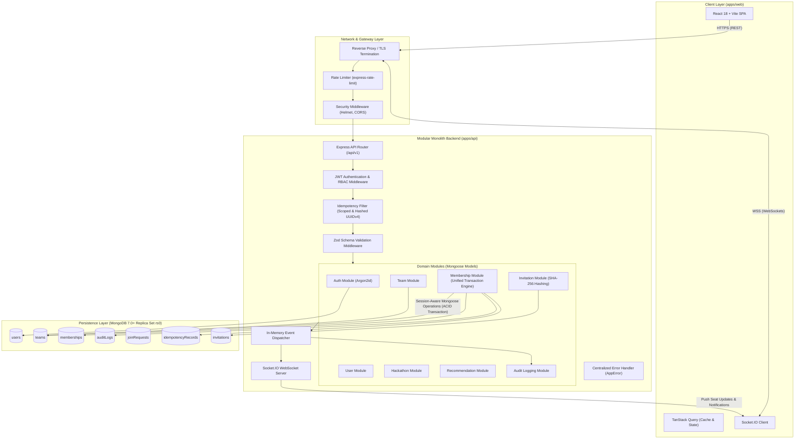
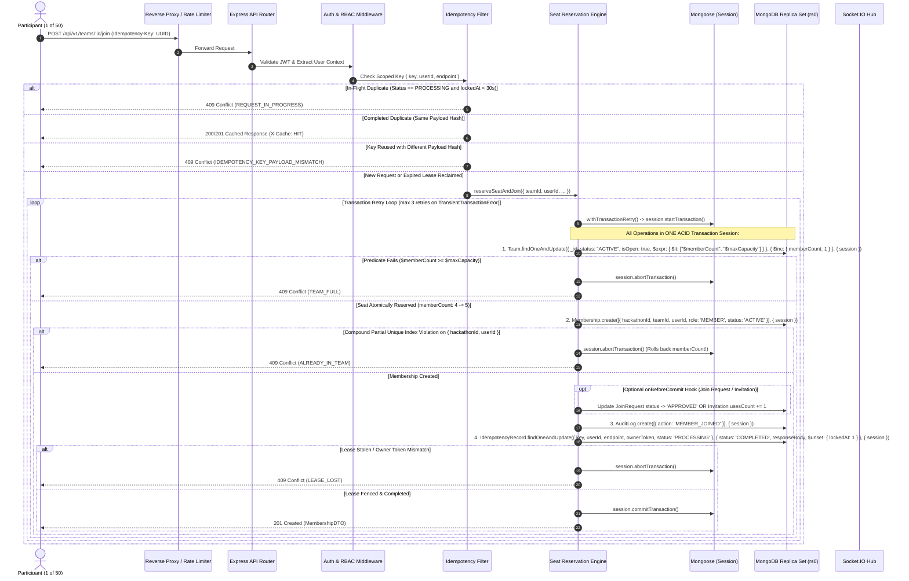

# CrewConnect — System Architecture Specification

**Document:** System Architecture  
**Author:** Senior Software Architect  
**Status:** Finalized & Approved  
**Version:** 1.1.0

---

## 1. Architectural Style & Core Technology Decisions

CrewConnect is engineered as a **Modular Monolith** deployed inside a type-safe TypeScript monorepo.

### Approved Core Technology Decisions

- **Package Manager:** **npm** (version >= 10.0.0). Retains the npm workspace configuration and unified `package-lock.json`. No migrations to pnpm.
- **Data Access Layer:** **Mongoose** (version 8.x+) as the sole, consistent data-access layer. All transactions and atomic updates use session-aware Mongoose operations (`.session(session)`). The native MongoDB driver is avoided unless a specific, documented limitation arises.
- **Password Hashing:** **Argon2id** using secure production parameters (memory cost: 64 MB, time cost: 3 iterations, parallelism: 1 thread, 16-byte random salt).
- **Core Frameworks:** React 18+ with Vite & Tailwind CSS on the frontend; Node.js v20+ with Express & TypeScript on the backend; MongoDB Replica Set (`rs0`) for persistence; Socket.IO for real-time bi-directional messaging.

---

## 2. High-Level Architecture Diagram



---

## 3. Layer Responsibilities & Subsystems

### A. Frontend Single Page Application (`apps/web`)

1. **Authentication Interface**:
   - Secure login and registration forms with client-side Zod validation.
   - Session recovery and automatic refresh via `httpOnly` cookies.
2. **Dashboard**:
   - Real-time status display of registered hackathons, current team membership, active invites, and incoming requests.
3. **Team Discovery Board**:
   - High-performance, paginated listing with instant search, debounce filtering, and real-time seat availability tags.
4. **Team Management View**:
   - Roster table with member role chips (`LEADER`, `MEMBER`).
   - Leader-specific actions: Transfer Leadership, Remove Member, Disband Team, Generate Secret Invite Code.
5. **Join Requests & Invitations**:
   - Actionable modals for non-team users to apply to open teams.
   - Inbox view for leaders to review and approve/reject pending join requests with optimistic UI feedback.
6. **Real-Time Notification Bar**:
   - Toast notifications and counter badges powered by WebSocket events.

### B. Backend Modular Monolith (`apps/api`)

1. **Authentication Module (`src/modules/auth`)**:
   - Password hashing exclusively using Argon2id with cryptographically secure random salt.
   - Generation and verification of JWT access tokens in `httpOnly`, `SameSite=Lax` cookies.
2. **User Profile Module (`src/modules/users`)**:
   - User profile CRUD, skills indexing, and hackathon registration status.
3. **Hackathon Module (`src/modules/hackathons`)**:
   - Hackathon lifecycle parameters, start/end dates, team size limits (`minTeamSize: 1`, `maxTeamSize: 5`).
4. **Team Module (`src/modules/teams`)**:
   - Team creation, profile updates, disbandment, and discovery query indexing.
5. **Membership Module (`src/modules/memberships`) — The Unified Transaction Core**:
   - Orchestrates the atomic conditional reservation, capacity increment, membership insertion, audit logging, and idempotency persistence inside a **single session-aware Mongoose transaction**.
   - Enforces the global invariant: **one team per user per hackathon**.
   - Enforces **leadership invariants**: leader must always be an active member; leader cannot leave or be removed without transfer or disbandment; atomic concurrent transfers; disbandment when the last member departs.
6. **Invitation Module (`src/modules/invitations`)**:
   - Cryptographically random invite token generation with SHA-256 token hashing for database storage.
   - Token redemption workflow routed through the Membership Transaction Engine.
7. **Join Request Module (`src/modules/join-requests`)**:
   - Candidate application queue with message support.
   - Leader approval workflow triggering atomic seat reservation and membership insertion.
8. **Recommendation Module (`src/modules/recommendations`)**:
   - Jaccard-similarity and weighted set intersection matching user skill vectors against team `skillsNeeded`.
9. **Audit Logging Module (`src/modules/audit`)**:
   - Append-only transactional event logger recording every team membership state transition.
10. **Real-Time Module (`src/modules/realtime`)**:
    - Authenticated Socket.IO server mapping connected sockets to `user:${userId}` and `team:${teamId}` rooms.

---

## 4. End-to-End Unified Transaction Lifecycle & Fenced Lease Protocol



---

## 5. Real-Time Communication Architecture

### Connection & Authentication Lifecycle

1. **Handshake**: The client initiates a WebSocket / HTTP long-polling connection (`io({ withCredentials: true })`) sending the signed session cookie (`token`), `Authorization: Bearer <token>`, or `handshake.auth.token`.
2. **Authentication Middleware (`apps/api/src/realtime/socket.ts`)**: The Socket.IO server verifies the JWT against `JWT_SECRET`, loads the user, confirms the account is `ACTIVE` (not `SUSPENDED`), and checks `payload.tokenVersion === user.tokenVersion`. Unauthenticated or revoked connections are rejected cleanly before joining any rooms.
3. **Least-Privilege Room Subscription**:
   - Each authenticated socket automatically joins a private user room: `user:${userId}`.
   - Joining `team:${teamId}` (`join:team`) queries `Membership.exists({ teamId, userId, status: "ACTIVE" })` and rejects non-members with `FORBIDDEN`.
   - Joining `hackathon:${hackathonId}` (`join:hackathon`) validates hackathon existence (`Hackathon.exists(...)`) before permitting directory capacity updates.
4. **Post-Commit Dispatch Invariant**:
   - Real-time notifications (`EventDispatcher`) are strictly executed **only after** `withTransactionRetry()` confirms `commitTransaction()` succeeded.
   - Aborted, rolled back, or uncertain commits (`TRANSACTION_COMMIT_UNCERTAIN`) **never** emit socket events. Transient retries inside `withTransactionRetry()` never produce duplicate events.

### Real-Time Event Matrix

| Event Name                    | Scope / Room                                 | Trigger Condition                            | Payload Summary                                                                                       |
| :---------------------------- | :------------------------------------------- | :------------------------------------------- | :---------------------------------------------------------------------------------------------------- |
| `team:capacity_updated`       | `hackathon:${hackathonId}`                   | Team created, visibility toggled, join/leave | `{ teamId, hackathonId, memberCount, maxCapacity, isOpen }`                                           |
| `team:member_joined`          | `team:${teamId}`                             | New member atomically committed              | `{ teamId, hackathonId, member: { userId, displayName, role }, memberCount, maxCapacity, isOpen }`    |
| `team:member_left`            | `team:${teamId}`, `user:${userId}`           | Member leaves or is removed                  | `{ teamId, hackathonId, userId, reason, memberCount, maxCapacity, isOpen }`                           |
| `team:updated`                | `team:${teamId}`, `hackathon:${hackathonId}` | Team profile edited by leader                | `{ teamId, hackathonId, name, tagline, description, skillsNeeded, isOpen, maxCapacity, memberCount }` |
| `team:leadership_transferred` | `team:${teamId}`                             | Leader transfers role to active member       | `{ teamId, hackathonId, previousLeaderId, newLeaderId, newLeaderDisplayName }`                        |
| `team:disbanded`              | `team:${teamId}`, `hackathon:${hackathonId}` | Last member leaves or leader disbands        | `{ teamId, hackathonId, disbandedBy }`                                                                |
| `team:join_request_submitted` | `user:${leaderId}`                           | Candidate submits join request               | `{ requestId, teamId, hackathonId, user: { id, displayName, skills }, message }`                      |
| `team:join_request_approved`  | `user:${candidateId}`                        | Leader approves join request                 | `{ requestId, teamId, hackathonId, userId, status: "APPROVED" }`                                      |
| `team:join_request_rejected`  | `user:${candidateId}`                        | Leader rejects join request                  | `{ requestId, teamId, hackathonId, userId, status: "REJECTED" }`                                      |

---

## 6. Error Handling Strategy

CrewConnect implements a centralized, typed error hierarchy adhering strictly to RFC 7807 problem details:

```typescript
export class AppError extends Error {
  constructor(
    message: string,
    public readonly code: string,
    public readonly statusCode: number = 500,
    public readonly details?: unknown
  ) {
    super(message);
    this.name = this.constructor.name;
    Object.setPrototypeOf(this, new.target.prototype);
  }
}
```

### Core Domain Error Code Catalog

- `UNAUTHORIZED` (401): Missing or expired authentication token.
- `FORBIDDEN` (403): User lacks permission (e.g. non-leader attempting to remove member).
- `NOT_FOUND` (404): Resource not found (team, user, hackathon, invitation).
- `VALIDATION_ERROR` (422): Zod schema parsing failure.
- `TEAM_FULL` (409): Capacity reached during atomic reservation.
- `TEAM_CLOSED` (409): Team is closed to new applicants.
- `ALREADY_IN_TEAM` (409): User already holds active membership in this hackathon.
- `LEADER_CANNOT_LEAVE` (400): Leader must transfer leadership or disband team.
- `REQUEST_IN_PROGRESS` (409): Idempotent request currently executing in-flight.
- `IDEMPOTENCY_KEY_PAYLOAD_MISMATCH` (409): Idempotency key reused with different body.
- `CONCURRENCY_CONFLICT` (409): Write conflict in MongoDB transaction after max retries.
- `LEASE_LOST` (409): Idempotency lease owner token mismatch during in-transaction completion.
- `IDEMPOTENCY_KEY_REQUIRED` (400): Mutating reservation endpoint called without Idempotency-Key.
- `IDEMPOTENCY_KEY_INVALID` (422): Key violates regex / character length limits (1-128 chars).

---

## 7. Race-Proof Membership & Idempotency Guarantee: Mathematical Invariant Proof

### 1. The 50-Concurrent-Requests Capacity Invariant

When 50 distinct authenticated participants concurrently attempt to join a team with exactly 1 vacancy remaining (`memberCount: 4`, `maxCapacity: 5`), the system provides a mathematical guarantee against overbooking:

$$\text{Final } memberCount = 5 \quad \land \quad |\text{Active Memberships}| = 5$$

#### Mathematical Invariant Proof:

1. **Storage Engine Serialization (WiredTiger MVCC & Document Locks)**:
   MongoDB executes document-level write modifications atomically. Every joining transaction executes:
   ```javascript
   Team.findOneAndUpdate(
     {
       _id: teamId,
       status: "ACTIVE",
       isOpen: true,
       $expr: { $lt: ["$memberCount", "$maxCapacity"] },
     },
     { $inc: { memberCount: 1 } },
     { new: true, session }
   );
   ```
2. **Serial Predicate Evaluation**:
   - Exactly one transaction $T_1$ acquires the document write lock first.
   - For $T_1$, `$expr: 4 < 5` evaluates to `TRUE`. The document is updated to `memberCount = 5` and $T_1$ proceeds.
   - For all subsequent transactions $T_2, \dots, T_{50}$ contending on the same document:
     - MongoDB detects write contention and raises `TransientTransactionError` (WriteConflict).
     - Under `withTransactionRetry()`, these transactions back off with full jitter and retry.
     - Upon retry, $T_1$ has already committed `memberCount: 5`.
     - The atomic filter `$expr: 5 < 5` evaluates to `FALSE`.
     - The atomic update returns `null` (zero documents matched).
3. **Clean Failure Path**:
   - The engine queries the current team state outside or within the transaction, observing `memberCount >= maxCapacity`.
   - The service rejects the request with HTTP `409 Conflict` and error code `TEAM_FULL`.
   - The transaction cleanly aborts with zero side-effects.
   - **Conclusion**: Overbooking is impossible. Exactly 1 request succeeds ($201\text{ Created}$) and 49 requests receive clean $409\text{ Conflict}$ errors.

### 2. Multi-Team Hackathon Seat Invariant (Compound Partial Unique Index)

To guarantee that a participant cannot occupy seats on multiple teams simultaneously in the same hackathon under concurrent race conditions:

$$\forall u \in \text{Users}, h \in \text{Hackathons}: \sum_{m \in \text{Memberships}(u, h)} [\text{status}(m) = \text{'ACTIVE'}] \le 1$$

- Enforced at the database storage engine layer via MongoDB partial unique index:
  ```javascript
  MembershipSchema.index(
    { hackathonId: 1, userId: 1 },
    { unique: true, partialFilterExpression: { status: "ACTIVE" } }
  );
  ```
- Any concurrent attempt to insert a second active membership inside a transaction triggers MongoDB E11000 duplicate key error, which `SeatReservationService` traps and maps to `409 Conflict (ALREADY_IN_TEAM)`.

### 3. Fenced Two-Phase Idempotency Lease Guarantee

To prevent double-execution, stale worker updates, and zombie transaction commits:

1. **Phase A (Outside Transaction — Lease Acquisition)**:
   - Atomically attempts insertion of `{ key, userId, endpoint, status: "PROCESSING", ownerToken: UUID, lockedAt: Date.now() }`.
   - If document exists with status `PROCESSING`:
     - If `lockedAt > Date.now() - 30s`: rejects with `409 REQUEST_IN_PROGRESS`.
     - If `lockedAt <= Date.now() - 30s` (stale worker / crash): atomically reclaims lease via Compare-And-Swap (CAS):
       ```javascript
       IdempotencyRecord.findOneAndUpdate(
         { key, userId, endpoint, status: "PROCESSING", lockedAt: existing.lockedAt },
         { $set: { lockedAt: new Date(), ownerToken: freshOwnerToken } },
         { new: true }
       );
       ```
   - If document exists with status `COMPLETED`: compares SHA-256 payload fingerprints. If identical, short-circuits execution and replays saved status code and cached JSON body with `X-Cache: HIT`. If payload differs, rejects with `409 IDEMPOTENCY_KEY_PAYLOAD_MISMATCH`.

2. **Phase B (Inside Transaction — Fencing & Completion)**:
   - The transition to `COMPLETED` is executed inside the business transaction:
     ```javascript
     IdempotencyRecord.findOneAndUpdate(
       { key, userId, endpoint, ownerToken, status: "PROCESSING" },
       {
         $set: { status: "COMPLETED", responseStatus, responseBody },
         $unset: { lockedAt: 1 },
       },
       { session }
     );
     ```
   - **Fencing Protection**: If the original worker stalled for $> 30\text{ seconds}$ and another worker reclaimed the lease, the `ownerToken` will not match. The query returns `null`, throwing `409 LEASE_LOST`.
   - This immediately rolls back the business transaction, mathematically preventing zombie commits from ever corrupting team capacity or roster state.
