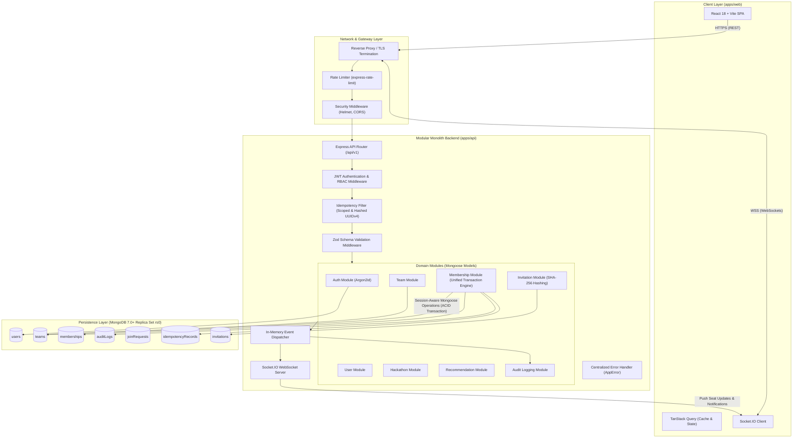
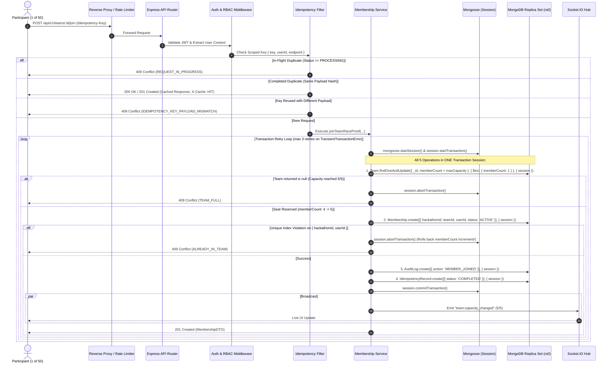

# CrewConnect — System Architecture Specification

**Document:** System Architecture  
**Author:** Senior Software Architect  
**Status:** Finalized & Approved  
**Version:** 1.1.0  

---

## 1. Architectural Style & Core Technology Decisions

CrewConnect is engineered as a **Modular Monolith** deployed inside a type-safe TypeScript monorepo.

### Approved Core Technology Decisions
- **Package Manager:** **npm** (version >= 10.0.0). Retains the npm workspace configuration and unified `package-lock.json`. No migrations to pnpm.
- **Data Access Layer:** **Mongoose** (version 8.x+) as the sole, consistent data-access layer. All transactions and atomic updates use session-aware Mongoose operations (`.session(session)`). The native MongoDB driver is avoided unless a specific, documented limitation arises.
- **Password Hashing:** **Argon2id** using secure production parameters (memory cost: 64 MB, time cost: 3 iterations, parallelism: 1 thread, 16-byte random salt).
- **Core Frameworks:** React 18+ with Vite & Tailwind CSS on the frontend; Node.js v20+ with Express & TypeScript on the backend; MongoDB Replica Set (`rs0`) for persistence; Socket.IO for real-time bi-directional messaging.

---

## 2. High-Level Architecture Diagram



---

## 3. Layer Responsibilities & Subsystems

### A. Frontend Single Page Application (`apps/web`)
1. **Authentication Interface**:
   - Secure login and registration forms with client-side Zod validation.
   - Session recovery and automatic refresh via `httpOnly` cookies.
2. **Dashboard**:
   - Real-time status display of registered hackathons, current team membership, active invites, and incoming requests.
3. **Team Discovery Board**:
   - High-performance, paginated listing with instant search, debounce filtering, and real-time seat availability tags.
4. **Team Management View**:
   - Roster table with member role chips (`LEADER`, `MEMBER`).
   - Leader-specific actions: Transfer Leadership, Remove Member, Disband Team, Generate Secret Invite Code.
5. **Join Requests & Invitations**:
   - Actionable modals for non-team users to apply to open teams.
   - Inbox view for leaders to review and approve/reject pending join requests with optimistic UI feedback.
6. **Real-Time Notification Bar**:
   - Toast notifications and counter badges powered by WebSocket events.

### B. Backend Modular Monolith (`apps/api`)
1. **Authentication Module (`src/modules/auth`)**:
   - Password hashing exclusively using Argon2id with cryptographically secure random salt.
   - Generation and verification of JWT access tokens in `httpOnly`, `SameSite=Lax` cookies.
2. **User Profile Module (`src/modules/users`)**:
   - User profile CRUD, skills indexing, and hackathon registration status.
3. **Hackathon Module (`src/modules/hackathons`)**:
   - Hackathon lifecycle parameters, start/end dates, team size limits (`minTeamSize: 1`, `maxTeamSize: 5`).
4. **Team Module (`src/modules/teams`)**:
   - Team creation, profile updates, disbandment, and discovery query indexing.
5. **Membership Module (`src/modules/memberships`) — The Unified Transaction Core**:
   - Orchestrates the atomic conditional reservation, capacity increment, membership insertion, audit logging, and idempotency persistence inside a **single session-aware Mongoose transaction**.
   - Enforces the global invariant: **one team per user per hackathon**.
   - Enforces **leadership invariants**: leader must always be an active member; leader cannot leave or be removed without transfer or disbandment; atomic concurrent transfers; disbandment when the last member departs.
6. **Invitation Module (`src/modules/invitations`)**:
   - Cryptographically random invite token generation with SHA-256 token hashing for database storage.
   - Token redemption workflow routed through the Membership Transaction Engine.
7. **Join Request Module (`src/modules/join-requests`)**:
   - Candidate application queue with message support.
   - Leader approval workflow triggering atomic seat reservation and membership insertion.
8. **Recommendation Module (`src/modules/recommendations`)**:
   - Jaccard-similarity and weighted set intersection matching user skill vectors against team `skillsNeeded`.
9. **Audit Logging Module (`src/modules/audit`)**:
   - Append-only transactional event logger recording every team membership state transition.
10. **Real-Time Module (`src/modules/realtime`)**:
    - Authenticated Socket.IO server mapping connected sockets to `user:${userId}` and `team:${teamId}` rooms.

---

## 4. End-to-End Unified Transaction Lifecycle



---

## 5. Real-Time Communication Architecture

### Connection & Authentication Lifecycle
1. **Handshake**: The client initiates a WebSocket connection (`wss://`) passing the JWT access token in the auth payload:
   ```javascript
   const socket = io({ auth: { token: 'jwt_token_here' } });
   ```
2. **Authentication Middleware**: The Socket.IO server verifies the token against `JWT_SECRET`. Unauthenticated connections are rejected with `UnauthorizedError`.
3. **Room Subscription**:
   - Each connected socket automatically joins a private user room: `user:${userId}`.
   - When viewing a hackathon dashboard, client joins `hackathon:${hackathonId}`.
   - When part of a team, client joins `team:${teamId}`.

### Real-Time Event Matrix
| Event Name | Scope / Room | Trigger Condition | Payload Data |
| :--- | :--- | :--- | :--- |
| `team:capacity_changed` | `hackathon:${hackathonId}` | Member joins or leaves a team | `{ teamId, memberCount, maxCapacity, isOpen }` |
| `team:member_joined` | `team:${teamId}` | New member successfully added | `{ teamId, member: { userId, name, role } }` |
| `team:member_removed` | `team:${teamId}`, `user:${userId}` | Member ejected or leaves | `{ teamId, userId, reason }` |
| `team:leadership_transferred`| `team:${teamId}` | Leader passes role to member | `{ teamId, previousLeaderId, newLeaderId }` |
| `team:disbanded` | `team:${teamId}`, `hackathon:${hackathonId}` | Last member leaves or leader disbands | `{ teamId, reason }` |
| `request:received` | `user:${leaderId}` | Candidate requests to join | `{ requestId, teamId, candidate: { userId, name } }` |
| `request:resolved` | `user:${candidateId}` | Leader approves or rejects | `{ requestId, teamId, status: "APPROVED" | "REJECTED" }` |
| `invitation:received` | `user:${targetUserId}` | Leader invites candidate | `{ invitationId, teamId, teamName }` |

---

## 6. Error Handling Strategy

CrewConnect implements a centralized, typed error hierarchy adhering strictly to RFC 7807 problem details:

```typescript
export class AppError extends Error {
  constructor(
    message: string,
    public readonly code: string,
    public readonly statusCode: number = 500,
    public readonly details?: unknown
  ) {
    super(message);
    this.name = this.constructor.name;
    Object.setPrototypeOf(this, new.target.prototype);
  }
}
```

### Core Domain Error Code Catalog
- `UNAUTHORIZED` (401): Missing or expired authentication token.
- `FORBIDDEN` (403): User lacks permission (e.g. non-leader attempting to remove member).
- `NOT_FOUND` (404): Resource not found (team, user, hackathon, invitation).
- `VALIDATION_ERROR` (422): Zod schema parsing failure.
- `TEAM_FULL` (409): Capacity reached during atomic reservation.
- `TEAM_CLOSED` (409): Team is closed to new applicants.
- `ALREADY_IN_TEAM` (409): User already holds active membership in this hackathon.
- `LEADER_CANNOT_LEAVE` (400): Leader must transfer leadership or disband team.
- `REQUEST_IN_PROGRESS` (409): Idempotent request currently executing in-flight.
- `IDEMPOTENCY_KEY_PAYLOAD_MISMATCH` (409): Idempotency key reused with different body.
- `CONCURRENCY_CONFLICT` (409): Write conflict in MongoDB transaction after max retries.
