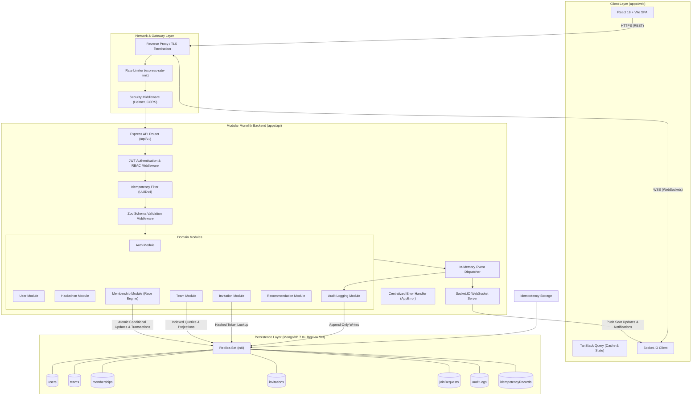
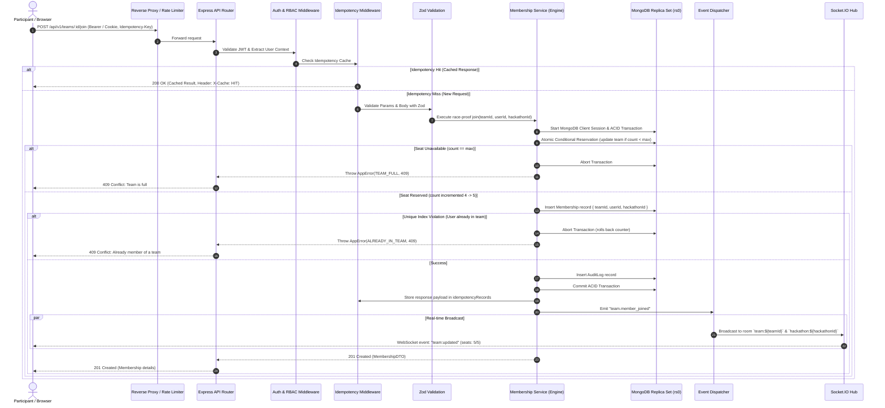

# CrewConnect — System Architecture Specification

**Document:** System Architecture  
**Author:** Senior Software Architect  
**Status:** Approved for Implementation  
**Version:** 1.0.0  

---

## 1. Architectural Style & Philosophy

CrewConnect is intentionally engineered as a **Modular Monolith** deployed inside a type-safe TypeScript monorepo. 

### Why a Modular Monolith over Microservices?
1. **Transaction Atomicity**: The central challenge is race-proof concurrency across multiple entities (teams, memberships, invitations, idempotency records). A modular monolith accessing a MongoDB replica set can leverage local ACID multi-document transactions with single-digit millisecond latency. Distributed transactions (2PC / Sagas) across microservices would introduce substantial latency, network partition failure modes, and eventual consistency delays that jeopardize the hard concurrency invariants of PS1.
2. **Zero Serialization & Network Overhead**: In-process domain communication between modules (e.g., membership service notifying audit service and real-time service) eliminates unnecessary serialization, inter-service HTTP hops, and distributed tracing complexity.
3. **Strict Domain Boundaries**: Each domain module (`auth`, `teams`, `memberships`, `invitations`, `recommendations`) is strictly isolated with clear public interfaces, domain services, and repository layers. If horizontal scaling requires extracting specific high-load read paths in the future (e.g., Team Discovery or Recommendation engine), modular monolith boundaries allow clean refactoring without architectural rewrites.

---

## 2. High-Level Architecture Diagram



---

## 3. Layer Responsibilities & Subsystems

### A. Frontend Single Page Application (`apps/web`)
1. **Authentication Interface**:
   - Secure login and registration forms with client-side Zod validation.
   - Session recovery and automatic refresh via `httpOnly` cookies.
2. **Dashboard**:
   - Real-time status display of registered hackathons, current team membership, active invites, and incoming requests.
3. **Team Discovery Board**:
   - High-performance, paginated listing with instant search, debounce filtering, and real-time seat availability tags.
   - Dynamic badges displaying remaining seats (`X / Y seats filled`).
4. **Team Management View**:
   - Roster table with member role chips (`LEADER`, `MEMBER`).
   - Leader-specific management actions: Transfer Leadership, Remove Member, Toggle Open/Closed, Generate Secret Invite Code.
5. **Join Requests & Invitations**:
   - Actionable modals for non-team users to apply to open teams.
   - Inbox view for leaders to review and approve/reject pending join requests with optimistic UI feedback.
6. **Real-Time Notification Bar**:
   - Toast notifications and counter badges powered by WebSocket events.

### B. Backend Modular Monolith (`apps/api`)
1. **Authentication Module (`src/modules/auth`)**:
   - Salted password hashing using Argon2id / bcrypt.
   - Generation and verification of short-lived JWT access tokens and secure refresh tokens.
2. **User Profile Module (`src/modules/users`)**:
   - User profile CRUD, skills indexing, and hackathon registration status.
3. **Hackathon Module (`src/modules/hackathons`)**:
   - Hackathon lifecycle parameters, start/end dates, team size limits (`minTeamSize: 1`, `maxTeamSize: 5`).
4. **Team Module (`src/modules/teams`)**:
   - Team creation, profile updates, team disbandment, and discovery query indexing.
5. **Membership Module (`src/modules/memberships`) — The Concurrency Core**:
   - Orchestrates the atomic conditional reservation and multi-document transaction for race-proof joining.
   - Enforces the global invariant: **one team per user per hackathon**.
   - Handles voluntary departure, member ejection, and leadership succession.
6. **Invitation Module (`src/modules/invitations`)**:
   - Cryptographically random invite token generation.
   - SHA-256 token hashing for secure database storage.
   - Token redemption workflow routed through the Membership Concurrency Engine.
7. **Join Request Module (`src/modules/join-requests`)**:
   - Candidate application queue with message support.
   - Leader approval workflow triggering atomic seat reservation and membership insertion.
8. **Recommendation Module (`src/modules/recommendations`)**:
   - Jaccard-similarity and weighted set intersection matching user skill vectors against team `skillsNeeded`.
9. **Audit Logging Module (`src/modules/audit`)**:
   - Append-only transactional event logger recording every team membership state transition.
10. **Real-Time Module (`src/modules/realtime`)**:
    - Authenticated Socket.IO server mapping connected sockets to `user:${userId}` and `team:${teamId}` rooms.

### C. Persistence Layer (MongoDB 7.0+ Replica Set)
- Standalone MongoDB instances do not support ACID transactions (`session.startTransaction()`).
- CrewConnect enforces a Replica Set (`rs0`) locally via Docker Compose and in production.
- Atomic conditional updates (`$inc: { memberCount: 1 }` with `{ memberCount: { $lt: maxCapacity } }`) eliminate write-lock contention.
- Compound unique indexes guarantee schema-level consistency even under transaction retries.

---

## 4. End-to-End Request Lifecycle



---

## 5. Real-Time Communication Architecture

### Connection & Authentication Lifecycle
1. **Handshake**: The client initiates a WebSocket connection (`wss://`) passing the JWT access token in the auth payload:
   ```javascript
   const socket = io({ auth: { token: 'jwt_token_here' } });
   ```
2. **Authentication Middleware**: The Socket.IO server verifies the token against `JWT_SECRET`. Unauthenticated connections are rejected with `UnauthorizedError`.
3. **Room Subscription**:
   - Each connected socket automatically joins a private user room: `user:${userId}`.
   - When viewing a hackathon dashboard, client joins `hackathon:${hackathonId}`.
   - When part of a team, client joins `team:${teamId}`.

### Real-Time Event Matrix
| Event Name | Scope / Room | Trigger Condition | Payload Data |
| :--- | :--- | :--- | :--- |
| `team:capacity_changed` | `hackathon:${hackathonId}` | Member joins or leaves a team | `{ teamId, memberCount, maxCapacity, isOpen }` |
| `team:member_joined` | `team:${teamId}` | New member successfully added | `{ teamId, member: { userId, name, role } }` |
| `team:member_removed` | `team:${teamId}`, `user:${userId}` | Member ejected or leaves | `{ teamId, userId, reason }` |
| `team:leadership_transferred`| `team:${teamId}` | Leader passes role to member | `{ teamId, previousLeaderId, newLeaderId }` |
| `request:received` | `user:${leaderId}` | Candidate requests to join | `{ requestId, teamId, candidate: { userId, name } }` |
| `request:resolved` | `user:${candidateId}` | Leader approves or rejects | `{ requestId, teamId, status: "APPROVED" | "REJECTED" }` |
| `invitation:received` | `user:${targetUserId}` | Leader invites candidate | `{ invitationId, teamId, teamName }` |

---

## 6. Error Handling Strategy

CrewConnect implements a centralized, typed error hierarchy adhering strictly to RFC 7807 problem details:

```typescript
export class AppError extends Error {
  constructor(
    message: string,
    public readonly code: string,
    public readonly statusCode: number = 500,
    public readonly details?: unknown
  ) {
    super(message);
    this.name = this.constructor.name;
    Object.setPrototypeOf(this, new.target.prototype);
  }
}
```

### Standard Error Response Envelope
Every client-facing error follows an identical, predictable JSON contract:
```json
{
  "error": {
    "code": "TEAM_FULL",
    "message": "The team has reached its maximum member capacity (5/5).",
    "details": {
      "teamId": "65e2b4f910a2b8e3a1f9a001",
      "currentCapacity": 5,
      "maxCapacity": 5
    },
    "timestamp": "2026-11-09T22:00:00.000Z",
    "requestId": "req_8df7a19c"
  }
}
```

### Core Domain Error Code Catalog
- `UNAUTHORIZED` (401): Missing or expired authentication token.
- `FORBIDDEN` (403): User lacks permission (e.g. non-leader attempting to remove member).
- `NOT_FOUND` (404): Resource not found (team, user, hackathon, invitation).
- `VALIDATION_ERROR` (422): Zod schema parsing failure.
- `TEAM_FULL` (409): Capacity reached during atomic reservation.
- `ALREADY_IN_TEAM` (409): User already holds active membership in this hackathon.
- `INVITATION_INVALID` (400): Invite code does not exist, has expired, or exceeded max redemptions.
- `CONCURRENCY_CONFLICT` (409): Write conflict in MongoDB transaction after max retries.
- `IDEMPOTENT_REPLAY` (200/201): Cached response returned for repeated idempotent request.
