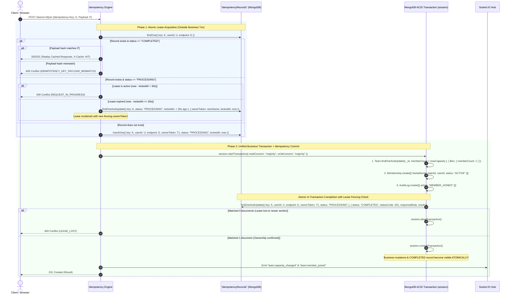

# CrewConnect — Concurrency Architecture & Race-Proof Membership Engine

**Document:** Concurrency Architecture  
**Author:** Senior Concurrency & Systems Architect  
**Status:** Finalized & Approved  
**Version:** 1.3.0  

---

## 1. The Core Concurrency Problem: 50 Users Racing for 1 Seat

### The Concrete Scenario
- **Team State**: Initial state: `memberCount: 4`, `maxCapacity: 5`. Vacant seats: **strictly 1**.
- **Traffic**: **50 distinct registered participants** simultaneously trigger a join request (via direct open join, invitation code redemption, or leader acceptance) at the exact same millisecond.
- **Strict Invariants to Satisfy**:
  1. **Strict Seat Allocation**: Exactly **one** of the 50 participants must obtain the 5th seat.
  2. **Clean Rejection**: The remaining **49 participants** must receive an immediate, typed `409 Conflict (TEAM_FULL)` response with zero corrupt side effects.
  3. **Zero Counter Inconsistency**: `team.memberCount` must equal **5**, never 6, never 4.
  4. **Single-Team Invariant**: If any of those 50 users is simultaneously competing for a seat in another team, the user must belong to at most one team in the hackathon.
  5. **No Phantom or Orphan Records**: No `memberships` document may exist without the team counter reflecting it, and vice versa.
  6. **Zero Orphaned Increments on Failure**: If any secondary operation fails, the entire transaction rolls back, restoring `memberCount` to 4.
  7. **Atomic Idempotency Crash-Consistency**: The business mutations and the idempotency transition to `COMPLETED` become committed and visible **atomically**. A crash can never leave an unrecorded completed business mutation.

---

## 2. Corrected Idempotency Architecture: Atomic Lease with In-Transaction Completion

### The Post-Commit Crash Flaw in Previous Designs
If an application marks an idempotency record `COMPLETED` *after* the business transaction commits, a crash window exists:
If the database primary commits the membership and capacity changes, but the Node.js process crashes (or is killed) before executing the post-commit idempotency update, the record remains in `PROCESSING`. Eventually, the 30-second lease expires. When the client retries, the system treats the expired lease as a crashed uncommitted request, reclaims the lease, and **re-executes the business operation a second time**, violating idempotency!

### The Solution: Fenced Lease Acquisition with In-Transaction Atomic Completion

To achieve mathematical crash-consistency without distributed transactions:
1. **Lease Acquisition Outside Transaction**: Reserve the key with a unique `ownerToken` (UUIDv4) and lease timestamp (`lockedAt: new Date()`).
2. **Atomic Transition Inside Transaction**: Move the idempotency status from `PROCESSING` to `COMPLETED` **inside the same MongoDB ACID transaction as the business mutations**.
3. **Lease Ownership Verification**: The conditional update inside the transaction strictly asserts `{ ownerToken, status: "PROCESSING" }`. If a slow worker had its lease reclaimed, the update matches 0 documents and the transaction aborts automatically.



---

## 3. Lease Ownership, Fencing & Crash Recovery Guarantees

### A. Unique Owner Token & Monotonic Fencing
- Every lease acquisition assigns a cryptographically unique `ownerToken` (UUIDv4) to the lease.
- When an expired lease is reclaimed, `findOneAndUpdate` atomically replaces `ownerToken` with a new token and resets `lockedAt: new Date()`.
- **Fencing Stale Workers**: If Worker A stalls (e.g. prolonged GC pause or network partition $> 30\text{ s}$) and Worker B reclaims the lease, Worker A's subsequent in-transaction update:
  ```typescript
  IdempotencyRecord.findOneAndUpdate(
    { key, userId, endpoint, ownerToken: workerA_Token, status: "PROCESSING" },
    { status: "COMPLETED", ... },
    { session }
  )
  ```
  matches **zero documents** because the `ownerToken` in the database is now `workerB_Token`. Worker A detects `matchedCount === 0`, immediately calls `session.abortTransaction()`, and rolls back all business mutations. Stale workers can **never** commit business mutations or corrupt state.

### B. Scoped Cleanup on Non-Retriable Failures
- If the business transaction fails due to a domain error (e.g., `TEAM_FULL`, `ALREADY_IN_TEAM`) or client validation failure, the application performs cleanup:
  ```typescript
  await IdempotencyRecord.deleteOne({
    key,
    userId,
    endpoint,
    ownerToken: currentOwnerToken,
    status: "PROCESSING"
  });
  ```
- Because cleanup requires `ownerToken: currentOwnerToken`, a stale worker will **never delete or overwrite a newer worker's active lease**.
- Failed transactions **never** leave misleading `COMPLETED` records; subsequent requests with the same key can retry cleanly.

---

## 4. MongoDB Transaction Retry Semantics & Commit Uncertainty

We strictly distinguish between four error classes to ensure mathematically correct behavior under write contention and network partitions:

```
┌─────────────────────────────────────────┬─────────────────────────────────────────────────────────────┐
│ Error Class                             │ Exact System Action & Resulting HTTP Status                 │
├─────────────────────────────────────────┼─────────────────────────────────────────────────────────────┤
│ 1. TransientTransactionError (Code 112) │ Abort transaction. Rerun ENTIRE business callback from the   │
│    (WiredTiger document write conflict) │ start with randomized jittered backoff:                     │
│                                         │ delay = min(50 * 2^(attempt-1) + rand(0, 50), 300) ms.      │
├─────────────────────────────────────────┼─────────────────────────────────────────────────────────────┤
│ 2. UnknownTransactionCommitResult       │ Do NOT rerun business callback! Retry ONLY the commit       │
│    (Commit sent, network dropped)       │ command (session.commitTransaction()) on the same session.  │
├─────────────────────────────────────────┼─────────────────────────────────────────────────────────────┤
│ 3. Deterministic Domain Errors          │ Abort transaction immediately. Do NOT retry.                │
│    - Duplicate membership (Code 11000)  │ -> 409 Conflict (ALREADY_IN_TEAM)                           │
│    - Capacity full (4/5 seats claimed)  │ -> 409 Conflict (TEAM_FULL)                                 │
├─────────────────────────────────────────┼─────────────────────────────────────────────────────────────┤
│ 4. Exhausted Retries (After 3 attempts) │ Abort transaction. Throw AppError:                          │
│                                         │ -> 409 Conflict (CONCURRENCY_CONFLICT)                      │
│                                         │ (Never falsely reported as TEAM_FULL!)                      │
└─────────────────────────────────────────┴─────────────────────────────────────────────────────────────┘
```

### Commit Uncertainty Resolution:
If network connectivity between the application server and MongoDB primary drops during `commitTransaction()` and exhausts the commit retry budget:
1. **Preserve Idempotency Record**: The application server does **NOT** delete the idempotency record.
2. **Safe Discovery on Retry**:
   - If the commit had successfully reached the MongoDB primary before the network dropped, the `idempotencyRecord` was committed as `status: "COMPLETED"` within that same atomic commit. A client retry reads `status: "COMPLETED"` and immediately receives the cached result.
   - If the commit never took place, the transaction was rolled back by MongoDB's cluster coordinator. The `idempotencyRecord` remains in `PROCESSING`. Once the 30-second lease window elapses, the client retry reclaims the lease and safely executes the transaction.
   - This completely eliminates ambiguity and double-execution under partition conditions.

---

## 5. Production Transaction Runner Implementation Blueprint

```typescript
import mongoose, { ClientSession } from "mongoose";
import { AppError } from "../errors/AppError.js";

export interface TransactionOptions {
  maxRetries?: number;
  baseDelayMs?: number;
  maxDelayMs?: number;
}

export async function executeInTransaction<T>(
  operation: (session: ClientSession) => Promise<T>,
  options: TransactionOptions = {}
): Promise<T> {
  const { maxRetries = 3, baseDelayMs = 50, maxDelayMs = 300 } = options;

  let lastError: any;

  for (let attempt = 1; attempt <= maxRetries; attempt++) {
    const session = await mongoose.startSession();
    try {
      session.startTransaction({
        readConcern: { level: "majority" },
        writeConcern: { w: "majority", j: true }
      });

      // 1. Execute business operation callback (includes in-transaction idempotency completion)
      const result = await operation(session);

      // 2. Commit transaction with specific UnknownTransactionCommitResult retry handling
      await commitWithRetry(session);

      return result;
    } catch (error: any) {
      await session.abortTransaction();
      lastError = error;

      // Handle transient write conflicts
      const isTransient =
        error.hasErrorLabel?.("TransientTransactionError") ||
        error.code === 112; // WriteConflict code

      if (isTransient && attempt < maxRetries) {
        const jitter = Math.random() * 50;
        const delay = Math.min(baseDelayMs * Math.pow(2, attempt - 1) + jitter, maxDelayMs);
        await new Promise((resolve) => setTimeout(resolve, delay));
        continue;
      }

      // Non-transient domain errors (TEAM_FULL, ALREADY_IN_TEAM, LEASE_LOST) fail immediately
      throw error;
    } finally {
      await session.endSession();
    }
  }

  // Explicitly report CONCURRENCY_CONFLICT, never TEAM_FULL
  throw new AppError(
    "Operation failed due to concurrent write contention. Please retry.",
    "CONCURRENCY_CONFLICT",
    409,
    { originalError: lastError?.message }
  );
}

/**
 * Specifically retries ONLY the commit command if acknowledgment was lost.
 * Never reruns the business callback!
 */
async function commitWithRetry(session: ClientSession, maxCommitAttempts = 3): Promise<void> {
  for (let i = 1; i <= maxCommitAttempts; i++) {
    try {
      await session.commitTransaction();
      return;
    } catch (error: any) {
      if (error.hasErrorLabel?.("UnknownTransactionCommitResult") && i < maxCommitAttempts) {
        await new Promise((resolve) => setTimeout(resolve, 50 * i));
        continue;
      }
      throw error;
    }
  }
}
```

---

## 6. End-to-End Membership Service Implementation Blueprint

```typescript
import crypto from "crypto";
import { executeInTransaction } from "./transactionRunner.js";
import { Team } from "../models/Team.js";
import { Membership } from "../models/Membership.js";
import { AuditLog } from "../models/AuditLog.js";
import { IdempotencyRecord } from "../models/IdempotencyRecord.js";
import { AppError } from "../errors/AppError.js";

export async function joinTeamRaceProof(
  teamId: string,
  userId: string,
  hackathonId: string,
  idempotencyKey?: string,
  rawPayload: any = {}
): Promise<JoinTeamResult> {
  const endpoint = "POST /api/v1/teams/:id/join";
  const payloadHash = crypto.createHash("sha256").update(JSON.stringify(rawPayload)).digest("hex");
  const ownerToken = crypto.randomUUID();

  // =========================================================================
  // Step 1: Atomic Idempotency Lease Acquisition (OUTSIDE Transaction)
  // =========================================================================
  if (idempotencyKey) {
    const existing = await IdempotencyRecord.findOne({
      key: idempotencyKey,
      userId,
      endpoint
    });

    if (existing) {
      if (existing.status === "COMPLETED") {
        if (existing.payloadHash !== payloadHash) {
          throw new AppError(
            "Idempotency key reused with different request payload",
            "IDEMPOTENCY_KEY_PAYLOAD_MISMATCH",
            409
          );
        }
        return existing.responseBody;
      }

      if (existing.status === "PROCESSING") {
        const isLeaseActive = Date.now() - existing.lockedAt.getTime() < 30000;
        if (isLeaseActive) {
          throw new AppError(
            "A request with this idempotency key is currently processing",
            "REQUEST_IN_PROGRESS",
            409
          );
        }

        // Reclaim expired lease with atomic owner fencing
        const reclaimed = await IdempotencyRecord.findOneAndUpdate(
          {
            key: idempotencyKey,
            userId,
            endpoint,
            status: "PROCESSING",
            lockedAt: existing.lockedAt
          },
          {
            $set: {
              ownerToken,
              payloadHash,
              lockedAt: new Date()
            }
          },
          { new: true }
        );

        if (!reclaimed) {
          throw new AppError(
            "Concurrent lease acquisition conflict. Please retry.",
            "REQUEST_IN_PROGRESS",
            409
          );
        }
      }
    } else {
      try {
        await IdempotencyRecord.create({
          key: idempotencyKey,
          userId,
          endpoint,
          payloadHash,
          ownerToken,
          status: "PROCESSING",
          lockedAt: new Date(),
          expiresAt: new Date(Date.now() + 24 * 60 * 60 * 1000)
        });
      } catch (err: any) {
        if (err.code === 11000) {
          throw new AppError(
            "A request with this idempotency key is currently processing",
            "REQUEST_IN_PROGRESS",
            409
          );
        }
        throw err;
      }
    }
  }

  // =========================================================================
  // Step 2: Unified Mongoose Business Transaction + In-Transaction Completion
  // =========================================================================
  let deferredEvents: Array<() => void> = [];
  let result: JoinTeamResult;

  try {
    result = await executeInTransaction(async (session) => {
      // 2a. Atomic Capacity Check & Reservation
      const updatedTeam = await Team.findOneAndUpdate(
        {
          _id: teamId,
          hackathonId,
          isOpen: true,
          $expr: { $lt: ["$memberCount", "$maxCapacity"] }
        },
        { $inc: { memberCount: 1 } },
        { session, new: true }
      );

      if (!updatedTeam) {
        const teamExists = await Team.findById(teamId).session(session);
        if (!teamExists) throw new AppError("Team not found", "NOT_FOUND", 404);
        if (!teamExists.isOpen) throw new AppError("Team is closed to new members", "TEAM_CLOSED", 409);
        throw new AppError("Team has reached maximum capacity (5/5)", "TEAM_FULL", 409, {
          currentCapacity: teamExists.memberCount,
          maxCapacity: teamExists.maxCapacity
        });
      }

      // 2b. Insert Active Membership (Guarded by Unique Partial Index)
      try {
        await Membership.create(
          [
            {
              hackathonId,
              teamId,
              userId,
              role: "MEMBER",
              status: "ACTIVE",
              joinedAt: new Date()
            }
          ],
          { session }
        );
      } catch (err: any) {
        if (err.code === 11000) {
          throw new AppError(
            "Participant is already an active member of a team in this hackathon",
            "ALREADY_IN_TEAM",
            409
          );
        }
        throw err;
      }

      // 2c. Insert Auditable Event Log
      await AuditLog.create(
        [
          {
            hackathonId,
            teamId,
            actorId: userId,
            action: "MEMBER_JOINED",
            metadata: {
              newMemberCount: updatedTeam.memberCount,
              maxCapacity: updatedTeam.maxCapacity
            },
            timestamp: new Date()
          }
        ],
        { session }
      );

      const payload: JoinTeamResult = {
        teamId: updatedTeam._id.toString(),
        userId,
        role: "MEMBER",
        memberCount: updatedTeam.memberCount,
        maxCapacity: updatedTeam.maxCapacity,
        joinedAt: new Date()
      };

      // 2d. In-Transaction Idempotency Completion & Fencing Verification
      if (idempotencyKey) {
        const completedRecord = await IdempotencyRecord.findOneAndUpdate(
          {
            key: idempotencyKey,
            userId,
            endpoint,
            ownerToken,
            status: "PROCESSING"
          },
          {
            $set: {
              status: "COMPLETED",
              statusCode: 201,
              responseBody: payload,
              completedAt: new Date()
            },
            $unset: { lockedAt: 1 }
          },
          { session, new: true }
        );

        if (!completedRecord) {
          // Lease was reclaimed by another worker or fenced! Abort transaction!
          throw new AppError(
            "Idempotency lease ownership lost during execution. Transaction aborted.",
            "LEASE_LOST",
            409
          );
        }
      }

      // 2e. Prepare Deferred Events (Emitted strictly post-commit)
      deferredEvents.push(() => {
        io.to(`hackathon:${hackathonId}`).emit("team:capacity_changed", {
          teamId: updatedTeam._id.toString(),
          memberCount: updatedTeam.memberCount,
          maxCapacity: updatedTeam.maxCapacity
        });
        io.to(`team:${teamId}`).emit("team:member_joined", {
          teamId: updatedTeam._id.toString(),
          userId,
          role: "MEMBER"
        });
      });

      return payload;
    });

    // =========================================================================
    // Step 3: Dispatch External Events ONLY After Confirmed Commit
    // =========================================================================
    deferredEvents.forEach((dispatch) => dispatch());

    return result;
  } catch (error) {
    // =========================================================================
    // Step 4: Scoped Cleanup on Failure (Only if STILL owned by current worker)
    // =========================================================================
    if (idempotencyKey) {
      await IdempotencyRecord.deleteOne({
        key: idempotencyKey,
        userId,
        endpoint,
        ownerToken,
        status: "PROCESSING"
      });
    }
    throw error;
  }
}
```

---

## 7. Mathematical Verification & Invariant Proof

Let $C_t$ be the team's member count at time $t$. Let $M = 5$. Initial count: $C_0 = 4$.

1. **Storage Serialization**: MongoDB WiredTiger serializes write locks on document $T$.
2. **First Transaction $T_1$**: Evaluates $C_0 = 4 < 5$. Condition holds true. $T_1$ increments $C \to 5$, creates membership, records audit log, updates idempotency lease to `COMPLETED`, and commits atomically.
3. **Contending Transactions $T_2 \dots T_{50}$**:
   - Catch `TransientTransactionError` during $T_1$'s active write ticket, back off with jitter, and re-attempt.
   - Upon wake-up, evaluate $C = 5 < 5 \implies \text{FALSE}$.
   - Match 0 documents. `findOneAndUpdate` returns `null`.
   - Abort cleanly with `409 Conflict (TEAM_FULL)`.
4. **Failure Rollback Invariant**: If a candidate already has an active team in Hackathon $H$, the unique compound partial index `{ hackathonId: 1, userId: 1 }` rejects the membership insertion with error code 11000. The transaction aborts, rolling back the increment on document $T$ and the idempotency record. $C$ is restored to 4.
5. **Crash Invariant**: If the application crashes before `session.commitTransaction()`, the transaction is aborted by MongoDB. If the application crashes *after* `session.commitTransaction()`, the idempotency record is already `COMPLETED` on the database primary. Subsequent retries replay the cached response. Double-execution probability is **strictly 0**.
