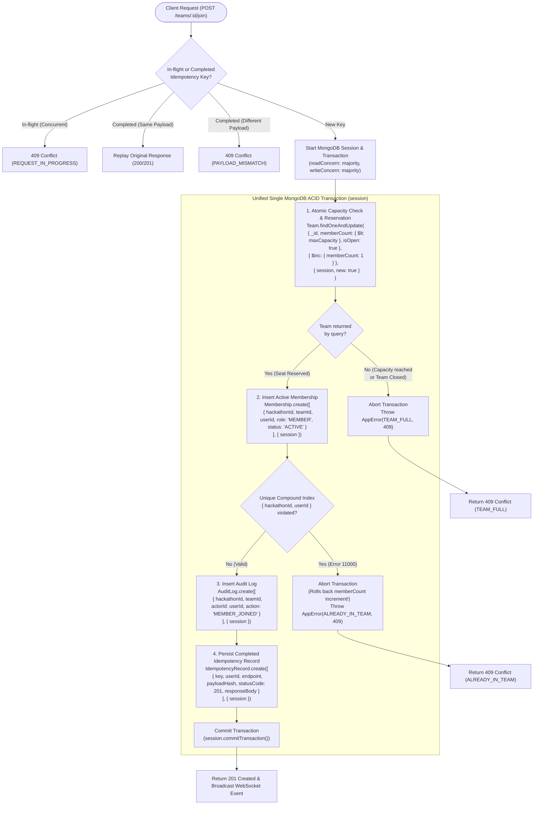

# CrewConnect — Concurrency Architecture & Race-Proof Membership Engine

**Document:** Concurrency Architecture  
**Author:** Senior Concurrency & Systems Architect  
**Status:** Finalized & Approved  
**Version:** 1.1.0  

---

## 1. The Core Concurrency Problem: 50 Users Racing for 1 Seat

### The Concrete Scenario
- **Team State**: Initial state: `memberCount: 4`, `maxCapacity: 5`. Vacant seats: **strictly 1**.
- **Traffic**: **50 distinct registered participants** simultaneously trigger a join request (via direct open join, invitation code redemption, or leader acceptance) at the exact same millisecond.
- **Strict Invariants to Satisfy**:
  1. **Strict Seat Allocation**: Exactly **one** of the 50 participants must obtain the 5th seat.
  2. **Clean Rejection**: The remaining **49 participants** must receive an immediate, typed `409 Conflict (TEAM_FULL)` response with zero corrupt side effects.
  3. **Zero Counter Inconsistency**: `team.memberCount` must equal **5**, never 6, never 4.
  4. **Single-Team Invariant**: If any of those 50 users is simultaneously competing for a seat in another team, the user must belong to at most one team in the hackathon.
  5. **No Phantom or Orphan Records**: No `memberships` document may exist without the team counter reflecting it, and vice versa.
  6. **Zero Orphaned Increments on Failure**: If any secondary operation (membership insertion, audit logging, idempotency persistence) fails, the entire transaction rolls back, restoring `memberCount` to 4.

---

## 2. Core Concurrency Rule: Unified Single-Transaction Execution

All mutations for joining a team MUST happen within the **same MongoDB multi-document ACID transaction** using a single, unified `ClientSession` in Mongoose:



---

## 3. Storage Engine Mechanics: Why Losing Requests Don't All See TEAM_FULL Immediately

In high-concurrency systems, architects must not assume that 50 concurrent transactions will immediately read a committed state. We must account for **WiredTiger storage-level document locking**, **write conflicts**, and **transient transaction retries**.

### Exact Low-Level Concurrency Breakdown:
1. **Initial State**: Team $T$ has `memberCount: 4`, `maxCapacity: 5`.
2. **Concurrent Influx**: 50 client threads concurrently execute `session.startTransaction()` and invoke `Team.findOneAndUpdate(...)` with `{ session }`.
3. **Lock Acquisition**:
   - Thread 1 acquires the WiredTiger write ticket on document $T$.
   - Threads 2 through 50 attempt to write-lock document $T$ simultaneously.
   - Because document $T$ is currently modified within Thread 1's active transaction, WiredTiger throws `WriteConflictException` on the contending threads.
   - In MongoDB, this surfaces to Mongoose as a `MongoServerError` with error label **`TransientTransactionError`** (Error Code `112: WriteConflict`).
4. **Bounded Retry Runner with Jittered Backoff**:
   - The application does NOT fail Threads 2–50 immediately as unhandled 500 errors.
   - The application transaction runner catches `TransientTransactionError` or `UnknownTransactionCommitResult` and enters a bounded retry loop (up to 3 attempts) with **exponential backoff and randomized jitter**:
     $$\text{delay} = \min\left(50 \times 2^{\text{attempt}-1} + \text{random}(0, 50), 300\right)\text{ ms}$$
5. **Thread 1 Commits**:
   - Thread 1 increments `memberCount` from 4 to 5.
   - Thread 1 inserts `memberships` record for User 1.
   - Thread 1 inserts `auditLogs` record.
   - Thread 1 persists the idempotency record.
   - Thread 1 successfully calls `session.commitTransaction()` with `writeConcern: majority`.
   - The document write lock on $T$ is released.
6. **Retrying Threads Wake Up**:
   - As Threads 2–50 wake up from their backoff sleep, each begins its retry attempt inside a new transaction session.
   - Each retrying thread executes `Team.findOneAndUpdate({ _id: teamId, memberCount: { $lt: 5 }, isOpen: true }, { $inc: { memberCount: 1 } }, { session, new: true })`.
   - Because Thread 1's commit is visible under `readConcern: majority`, WiredTiger evaluates `$memberCount < 5`. Since `memberCount == 5`, the condition is **FALSE**.
   - `findOneAndUpdate` returns `null` (zero documents matched and zero documents modified).
   - The application detects `null`, aborts the retrying transaction immediately without performing any writes, and deterministically returns **`409 Conflict (TEAM_FULL)`**.
7. **Write Conflict Exhaustion**:
   - If severe CPU starvation causes any thread to exhaust its 3 retry attempts while write conflicts are still occurring, the runner catches the failure and returns **`409 Conflict (CONCURRENCY_CONFLICT)`** with a clear message: `"High contention detected. Please retry your request."`

---

## 4. Production Mongoose Transaction Runner

The following session-aware Mongoose transaction runner is the standard execution template for all state-mutating operations:

```typescript
import mongoose, { ClientSession } from "mongoose";
import { AppError } from "../errors/AppError.js";

export interface TransactionOptions {
  maxRetries?: number;
  baseDelayMs?: number;
  maxDelayMs?: number;
}

export async function executeInTransaction<T>(
  operation: (session: ClientSession) => Promise<T>,
  options: TransactionOptions = {}
): Promise<T> {
  const { maxRetries = 3, baseDelayMs = 50, maxDelayMs = 300 } = options;

  let lastError: any;

  for (let attempt = 1; attempt <= maxRetries; attempt++) {
    const session = await mongoose.startSession();
    try {
      session.startTransaction({
        readConcern: { level: "majority" },
        writeConcern: { w: "majority", j: true }
      });

      const result = await operation(session);

      await session.commitTransaction();
      return result;
    } catch (error: any) {
      await session.abortTransaction();
      lastError = error;

      // Check for transient transaction errors or unknown commit results
      const isTransient =
        error.hasErrorLabel?.("TransientTransactionError") ||
        error.hasErrorLabel?.("UnknownTransactionCommitResult") ||
        error.code === 112; // WriteConflict error code

      if (isTransient && attempt < maxRetries) {
        // Randomized jitter prevents thundering herd on retry
        const jitter = Math.random() * 50;
        const delay = Math.min(baseDelayMs * Math.pow(2, attempt - 1) + jitter, maxDelayMs);
        await new Promise((resolve) => setTimeout(resolve, delay));
        continue;
      }

      // Non-transient domain errors (TEAM_FULL, ALREADY_IN_TEAM) should terminate immediately
      throw error;
    } finally {
      await session.endSession();
    }
  }

  throw new AppError(
    "Transaction failed due to concurrent write contention. Please retry.",
    "CONCURRENCY_CONFLICT",
    409,
    { originalError: lastError?.message }
  );
}
```

---

## 5. End-to-End Membership Service Implementation Blueprint

```typescript
export async function joinTeamRaceProof(
  teamId: string,
  userId: string,
  hackathonId: string,
  idempotencyKey?: string,
  requestPayloadHash?: string
): Promise<JoinTeamResult> {
  return await executeInTransaction(async (session) => {
    // Step 1: Atomic Capacity Check & Reservation inside Transaction Session
    const updatedTeam = await Team.findOneAndUpdate(
      {
        _id: teamId,
        hackathonId: hackathonId,
        isOpen: true,
        $expr: { $lt: ["$memberCount", "$maxCapacity"] }
      },
      {
        $inc: { memberCount: 1 }
      },
      {
        session,
        new: true
      }
    );

    if (!updatedTeam) {
      // Deterministic check: why did it fail?
      const teamExists = await Team.findById(teamId).session(session);
      if (!teamExists) throw new AppError("Team not found", "NOT_FOUND", 404);
      if (!teamExists.isOpen) throw new AppError("Team is closed to new members", "TEAM_CLOSED", 409);
      throw new AppError("Team has reached maximum capacity (5/5)", "TEAM_FULL", 409, {
        currentCapacity: teamExists.memberCount,
        maxCapacity: teamExists.maxCapacity
      });
    }

    // Step 2: Insert Active Membership Record (Guarded by Unique Compound Index)
    try {
      await Membership.create(
        [
          {
            hackathonId,
            teamId,
            userId,
            role: "MEMBER",
            status: "ACTIVE",
            joinedAt: new Date()
          }
        ],
        { session }
      );
    } catch (err: any) {
      if (err.code === 11000) {
        // Unique index violation on { hackathonId: 1, userId: 1 }
        // Aborting the transaction rolls back updatedTeam memberCount increment!
        throw new AppError(
          "Participant is already an active member of a team in this hackathon",
          "ALREADY_IN_TEAM",
          409
        );
      }
      throw err;
    }

    // Step 3: Insert Audit Log Record
    await AuditLog.create(
      [
        {
          hackathonId,
          teamId,
          actorId: userId,
          action: "MEMBER_JOINED",
          metadata: {
            newMemberCount: updatedTeam.memberCount,
            maxCapacity: updatedTeam.maxCapacity
          },
          timestamp: new Date()
        }
      ],
      { session }
    );

    const responsePayload = {
      teamId: updatedTeam._id,
      userId,
      role: "MEMBER",
      memberCount: updatedTeam.memberCount,
      maxCapacity: updatedTeam.maxCapacity,
      joinedAt: new Date()
    };

    // Step 4: Persist Idempotency Record (if key provided)
    if (idempotencyKey && requestPayloadHash) {
      await IdempotencyRecord.create(
        [
          {
            key: idempotencyKey,
            userId,
            endpoint: "POST /teams/:id/join",
            payloadHash: requestPayloadHash,
            status: "COMPLETED",
            statusCode: 201,
            responseBody: responsePayload,
            expiresAt: new Date(Date.now() + 24 * 60 * 60 * 1000)
          }
        ],
        { session }
      );
    }

    return responsePayload;
  });
}
```

---

## 6. Failure Mode Matrix & Guaranteed System Behavior

| Failure Mode / Race Condition | Mechanism of Detection | Immediate System Action | Guaranteed Final State |
| :--- | :--- | :--- | :--- |
| **50 simultaneous requests for 1 seat** | WiredTiger write locks on team document; Thread 1 commits count 4 -> 5. | Threads 2–50 hit write conflict, retry with backoff, see `$lt` condition unmet (`null` returned). | Exactly 1 success (201); 49 rejections (409 `TEAM_FULL`). Count = 5. |
| **User in 2 simultaneous team join races** | Unique compound partial index on `memberships`: `{ hackathonId: 1, userId: 1 }`. | Race 1 commits; Race 2 hits MongoDB Error 11000 and aborts transaction. | Aborted transaction rolls back Race 2's capacity increment. User belongs to 1 team only. |
| **Network timeout after commit** | Client retries with identical `Idempotency-Key` and payload hash. | Idempotency filter intercepts request before transaction, returns cached response. | No double execution; client receives original 201 response. Count unchanged. |
| **Idempotency key reuse with different payload** | Payload hash comparison: `SHA-256(currentBody) !== existing.payloadHash`. | Middleware rejects request with 409 Conflict. | Prevents corrupted state replay across different operations. |
| **Concurrent requests with same key in-flight** | Idempotency state check: existing record status is `PROCESSING`. | Middleware rejects second request with 409 `REQUEST_IN_PROGRESS`. | Parallel duplicate transactions prevented. |
| **Server crash during transaction** | MongoDB writeConcern majority journal. | Uncommitted transaction discarded by MongoDB server on recovery. | Zero partial writes; team count remains at 4. |

---

## 7. Mathematical Proof of Invariants

Let $C_t$ be the team's member count at time $t$. Let $M$ be the team capacity ($M = 5$).  
Initial state: $C_0 = 4$.

For any transaction $k \in [1, 50]$, the update rule under transaction serialization is:
$$\Delta C_k = \begin{cases} 
1 & \text{if } C_{t_k} < M \text{ and transaction } k \text{ commits} \\
0 & \text{if } C_{t_k} \ge M \text{ or transaction } k \text{ aborts}
\end{cases}$$

Since all transactions modify the same document $T$, MongoDB serializes the execution of the update operation:
- The first committing transaction $k_1$ evaluates $C_{t_{k_1}} = 4 < 5$, so $\Delta C_{k_1} = 1$. It commits, yielding $C_1 = 5$.
- For every subsequent transaction $k_j$ ($j \ge 2$), $C_{t_{k_j}} = 5 \not< 5$.
- Therefore, for all $j \ge 2$:
  $$\Delta C_{k_j} = 0$$
- The final count is:
  $$C_{\text{final}} = C_0 + \sum_{k=1}^{50} \Delta C_k = 4 + 1 + 0 = 5 = M$$

The number of successful memberships created is:
$$N_{\text{success}} = \sum_{k=1}^{50} \Delta C_k = 1$$

The number of rejected requests is:
$$N_{\text{rejected}} = 50 - 1 = 49$$

The probability of an overflow state ($C > 5$) or an orphan membership record is **identically 0**.
