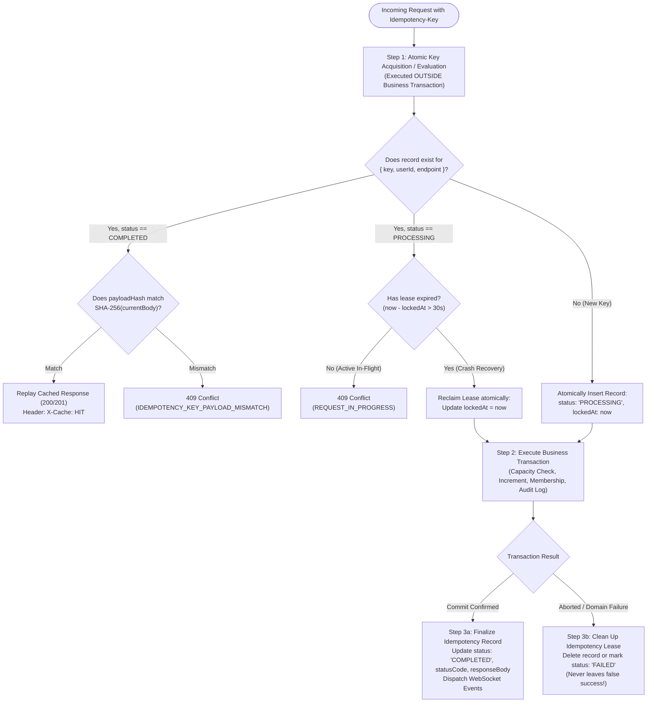

# CrewConnect — Concurrency Architecture & Race-Proof Membership Engine

**Document:** Concurrency Architecture  
**Author:** Senior Concurrency & Systems Architect  
**Status:** Finalized & Approved  
**Version:** 1.2.0  

---

## 1. The Core Concurrency Problem: 50 Users Racing for 1 Seat

### The Concrete Scenario
- **Team State**: Initial state: `memberCount: 4`, `maxCapacity: 5`. Vacant seats: **strictly 1**.
- **Traffic**: **50 distinct registered participants** simultaneously trigger a join request (via direct open join, invitation code redemption, or leader acceptance) at the exact same millisecond.
- **Strict Invariants to Satisfy**:
  1. **Strict Seat Allocation**: Exactly **one** of the 50 participants must obtain the 5th seat.
  2. **Clean Rejection**: The remaining **49 participants** must receive an immediate, typed `409 Conflict (TEAM_FULL)` response with zero corrupt side effects.
  3. **Zero Counter Inconsistency**: `team.memberCount` must equal **5**, never 6, never 4.
  4. **Single-Team Invariant**: If any of those 50 users is simultaneously competing for a seat in another team, the user must belong to at most one team in the hackathon.
  5. **No Phantom or Orphan Records**: No `memberships` document may exist without the team counter reflecting it, and vice versa.
  6. **Zero Orphaned Increments on Failure**: If any secondary operation (membership insertion, auditable event logging) fails, the entire transaction rolls back, restoring `memberCount` to 4.

---

## 2. Corrected Idempotency Architecture: Atomic Lease Acquisition Outside the Transaction

### The Visibility Dilemma in Transactions
Under MongoDB's Read Committed / Majority transaction isolation, uncommitted document writes created *inside* an active transaction are invisible to concurrent transactions. If Transaction A begins and writes a `PROCESSING` record inside its transaction, a concurrent Transaction B cannot see that uncommitted record.

### The Solution: Two-Phase Idempotency Lease Protocol
CrewConnect separates idempotency lease acquisition from the multi-document business transaction:



### Idempotency Correctness & Crash Recovery Guarantees
1. **Scoped Keys**: The unique compound index on `idempotencyRecords` (`{ key: 1, userId: 1, endpoint: 1 }`) guarantees that keys are strictly scoped per authenticated user and endpoint.
2. **In-Flight Lock**: If a duplicate concurrent request arrives while a transaction is actively running, it finds `status == "PROCESSING"` within its 30-second lease window and is immediately rejected with `409 Conflict (REQUEST_IN_PROGRESS)`.
3. **Payload Verification**: Any attempt to reuse a key with altered request parameters is trapped via SHA-256 payload fingerprinting and rejected with `409 Conflict (IDEMPOTENCY_KEY_PAYLOAD_MISMATCH)`.
4. **Crash Recovery**: If a server crashes or encounters an unhandled process kill during Step 2, the 30-second lease window expires. Any subsequent retry recognizes the expired lease, reclaims ownership, and safely re-executes.
5. **No False Success Records**: If the business transaction aborts (e.g., `TEAM_FULL` or `ALREADY_IN_TEAM`), Step 3b immediately deletes the in-flight lease or marks it `FAILED`. Failed transactions **never** leave misleading `COMPLETED` records.
6. **Role of TTL**: The MongoDB TTL index (`expiresAt: 24h`) is strictly for **eventual storage cleanup**, not for application correctness.

---

## 3. MongoDB Transaction Retry Semantics

We rigorously distinguish between four distinct error categories to prevent incorrect retries or misreported error codes:

| Error Category | Identification | Correct System Action | Resulting HTTP Response |
| :--- | :--- | :--- | :--- |
| **A. `TransientTransactionError`** | Error label `TransientTransactionError` or code 112 (`WriteConflict`). | **Abort transaction** (`session.abortTransaction()`). Rerun the **entire business callback** from the beginning with randomized jittered backoff. | Retried up to 3 times. If retries exhausted -> `409 Conflict (CONCURRENCY_CONFLICT)`. |
| **B. `UnknownTransactionCommitResult`** | Error label `UnknownTransactionCommitResult` on commit. | **Do NOT rerun business callback!** Re-invoke **ONLY** `session.commitTransaction()` on the existing session until confirmed or failed. | `201 Created` upon commit resolution. |
| **C. Deterministic Duplicate Key** | MongoDB Error code 11000 on `{ hackathonId: 1, userId: 1 }`. | **Non-transient domain violation!** Abort transaction immediately. **Do NOT retry.** | `409 Conflict (ALREADY_IN_TEAM)`. |
| **D. Application Capacity Limit** | `Team.findOneAndUpdate(...)` returns `null` (condition unmet). | **Non-transient domain condition!** Abort transaction immediately. **Do NOT retry.** | `409 Conflict (TEAM_FULL)`. |

### Important Execution Rules:
- **Never report `TEAM_FULL` on exhausted retries**: If 3 retries are exhausted due to continuous write conflicts under extreme load, the system returns `409 Conflict (CONCURRENCY_CONFLICT)` with a clear message: `"High concurrent contention. Please retry your request."` It never falsely blames a full team when the actual cause was lock contention.
- **Pure Callbacks**: The transaction callback must be strictly idempotent and safe to execute multiple times during transient error retries.
- **Side Effect Deferral (WebSockets)**: WebSocket broadcasts (`io.to(...).emit(...)`) and notifications are queued in-memory and emitted **ONLY AFTER** `session.commitTransaction()` has successfully resolved and returned confirmation.

---

## 4. Production Transaction Runner Implementation Blueprint

```typescript
import mongoose, { ClientSession } from "mongoose";
import { AppError } from "../errors/AppError.js";

export interface TransactionOptions {
  maxRetries?: number;
  baseDelayMs?: number;
  maxDelayMs?: number;
}

export async function executeInTransaction<T>(
  operation: (session: ClientSession) => Promise<T>,
  options: TransactionOptions = {}
): Promise<T> {
  const { maxRetries = 3, baseDelayMs = 50, maxDelayMs = 300 } = options;

  let lastError: any;

  for (let attempt = 1; attempt <= maxRetries; attempt++) {
    const session = await mongoose.startSession();
    try {
      session.startTransaction({
        readConcern: { level: "majority" },
        writeConcern: { w: "majority", j: true }
      });

      // Execute business operation callback
      const result = await operation(session);

      // Commit loop: handle UnknownTransactionCommitResult specifically
      await commitWithRetry(session);

      return result;
    } catch (error: any) {
      await session.abortTransaction();
      lastError = error;

      // Handle TransientTransactionError (e.g. WriteConflict)
      const isTransient =
        error.hasErrorLabel?.("TransientTransactionError") ||
        error.code === 112; // WriteConflict

      if (isTransient && attempt < maxRetries) {
        const jitter = Math.random() * 50;
        const delay = Math.min(baseDelayMs * Math.pow(2, attempt - 1) + jitter, maxDelayMs);
        await new Promise((resolve) => setTimeout(resolve, delay));
        continue;
      }

      // Non-transient errors (TEAM_FULL, ALREADY_IN_TEAM) or exhausted retries fail immediately
      throw error;
    } finally {
      await session.endSession();
    }
  }

  // Explicitly report CONCURRENCY_CONFLICT, never TEAM_FULL
  throw new AppError(
    "Operation failed due to concurrent write contention. Please retry.",
    "CONCURRENCY_CONFLICT",
    409,
    { originalError: lastError?.message }
  );
}

/**
 * Specifically retries ONLY the commit command if the commit result was unknown.
 * Does NOT re-execute the business logic!
 */
async function commitWithRetry(session: ClientSession, maxCommitAttempts = 3): Promise<void> {
  for (let i = 1; i <= maxCommitAttempts; i++) {
    try {
      await session.commitTransaction();
      return;
    } catch (error: any) {
      if (error.hasErrorLabel?.("UnknownTransactionCommitResult") && i < maxCommitAttempts) {
        await new Promise((resolve) => setTimeout(resolve, 50 * i));
        continue;
      }
      throw error;
    }
  }
}
```

---

## 5. End-to-End Membership Service Implementation

```typescript
export async function joinTeamRaceProof(
  teamId: string,
  userId: string,
  hackathonId: string,
  idempotencyKey?: string,
  rawPayload: any = {}
): Promise<JoinTeamResult> {
  const endpoint = "POST /api/v1/teams/:id/join";
  const payloadHash = crypto.createHash("sha256").update(JSON.stringify(rawPayload)).digest("hex");

  // =========================================================================
  // Step 1: Atomic Idempotency Lease Acquisition (OUTSIDE Transaction)
  // =========================================================================
  let idempotencyRecordId: string | null = null;
  if (idempotencyKey) {
    const existing = await IdempotencyRecord.findOne({
      key: idempotencyKey,
      userId,
      endpoint
    });

    if (existing) {
      if (existing.status === "COMPLETED") {
        if (existing.payloadHash !== payloadHash) {
          throw new AppError(
            "Idempotency key reused with different request payload",
            "IDEMPOTENCY_KEY_PAYLOAD_MISMATCH",
            409
          );
        }
        return existing.responseBody;
      }

      if (existing.status === "PROCESSING") {
        const isLeaseActive = Date.now() - existing.lockedAt.getTime() < 30000;
        if (isLeaseActive) {
          throw new AppError(
            "A request with this idempotency key is currently processing",
            "REQUEST_IN_PROGRESS",
            409
          );
        }
        // Reclaim expired lease (crash recovery)
        existing.lockedAt = new Date();
        await existing.save();
        idempotencyRecordId = existing._id.toString();
      }
    } else {
      try {
        const created = await IdempotencyRecord.create({
          key: idempotencyKey,
          userId,
          endpoint,
          payloadHash,
          status: "PROCESSING",
          lockedAt: new Date(),
          expiresAt: new Date(Date.now() + 24 * 60 * 60 * 1000)
        });
        idempotencyRecordId = created._id.toString();
      } catch (err: any) {
        if (err.code === 11000) {
          throw new AppError(
            "A request with this idempotency key is currently processing",
            "REQUEST_IN_PROGRESS",
            409
          );
        }
        throw err;
      }
    }
  }

  // =========================================================================
  // Step 2: Unified Mongoose Business Transaction
  // =========================================================================
  let deferredEvents: Array<() => void> = [];
  let result: JoinTeamResult;

  try {
    result = await executeInTransaction(async (session) => {
      // 2a. Atomic Capacity Check & Reservation
      const updatedTeam = await Team.findOneAndUpdate(
        {
          _id: teamId,
          hackathonId,
          isOpen: true,
          $expr: { $lt: ["$memberCount", "$maxCapacity"] }
        },
        { $inc: { memberCount: 1 } },
        { session, new: true }
      );

      if (!updatedTeam) {
        const teamExists = await Team.findById(teamId).session(session);
        if (!teamExists) throw new AppError("Team not found", "NOT_FOUND", 404);
        if (!teamExists.isOpen) throw new AppError("Team is closed to new members", "TEAM_CLOSED", 409);
        throw new AppError("Team has reached maximum capacity (5/5)", "TEAM_FULL", 409, {
          currentCapacity: teamExists.memberCount,
          maxCapacity: teamExists.maxCapacity
        });
      }

      // 2b. Insert Active Membership (Guarded by Unique Partial Index)
      try {
        await Membership.create(
          [
            {
              hackathonId,
              teamId,
              userId,
              role: "MEMBER",
              status: "ACTIVE",
              joinedAt: new Date()
            }
          ],
          { session }
        );
      } catch (err: any) {
        if (err.code === 11000) {
          // Aborting the transaction automatically rolls back updatedTeam counter increment!
          throw new AppError(
            "Participant is already an active member of a team in this hackathon",
            "ALREADY_IN_TEAM",
            409
          );
        }
        throw err;
      }

      // 2c. Insert Auditable Event Log
      await AuditLog.create(
        [
          {
            hackathonId,
            teamId,
            actorId: userId,
            action: "MEMBER_JOINED",
            metadata: {
              newMemberCount: updatedTeam.memberCount,
              maxCapacity: updatedTeam.maxCapacity
            },
            timestamp: new Date()
          }
        ],
        { session }
      );

      // 2d. Prepare Result and Deferred Event (NO in-transaction side effects)
      const payload: JoinTeamResult = {
        teamId: updatedTeam._id.toString(),
        userId,
        role: "MEMBER",
        memberCount: updatedTeam.memberCount,
        maxCapacity: updatedTeam.maxCapacity,
        joinedAt: new Date()
      };

      deferredEvents.push(() => {
        io.to(`hackathon:${hackathonId}`).emit("team:capacity_changed", {
          teamId: updatedTeam._id.toString(),
          memberCount: updatedTeam.memberCount,
          maxCapacity: updatedTeam.maxCapacity
        });
        io.to(`team:${teamId}`).emit("team:member_joined", {
          teamId: updatedTeam._id.toString(),
          userId,
          role: "MEMBER"
        });
      });

      return payload;
    });

    // =========================================================================
    // Step 3a: Finalize Idempotency Record (On Confirmed Success)
    // =========================================================================
    if (idempotencyRecordId) {
      await IdempotencyRecord.findByIdAndUpdate(idempotencyRecordId, {
        status: "COMPLETED",
        statusCode: 201,
        responseBody: result,
        lockedAt: null
      });
    }

    // Step 3b: Dispatch External Side Effects ONLY after Confirmed Commit
    deferredEvents.forEach((dispatch) => dispatch());

    return result;
  } catch (error) {
    // =========================================================================
    // Step 3c: Clean Up Idempotency Lease on Failure
    // =========================================================================
    if (idempotencyRecordId) {
      await IdempotencyRecord.findByIdAndDelete(idempotencyRecordId);
    }
    throw error;
  }
}
```

---

## 6. Mathematical Verification & Invariant Proof

Let $C_t$ be the team's member count at time $t$. Let $M = 5$. Initial count: $C_0 = 4$.

1. **Storage Serialization**: MongoDB WiredTiger serializes write locks on the document $T$.
2. **First Transaction $T_1$**: Evaluates $C_0 = 4 < 5$. Condition holds true. $T_1$ increments $C \to 5$ and commits.
3. **Contending Transactions $T_2 \dots T_{50}$**:
   - Encounter `WriteConflict` during $T_1$'s active lock, catch `TransientTransactionError`, and back off with jitter.
   - Upon wake-up, evaluate $C = 5 < 5 \implies \text{FALSE}$.
   - Match 0 documents. `findOneAndUpdate` returns `null`.
   - Abort cleanly with `409 Conflict (TEAM_FULL)`.
4. **Failure Rollback Invariant**: If a candidate already has an active team in Hackathon $H$, the unique compound partial index `{ hackathonId: 1, userId: 1 }` rejects the membership insertion with error code 11000. The transaction aborts, rolling back the increment on document $T$. $C$ is restored to 4.
5. **Result**: Strictly 1 successful membership; 49 clean rejections; $C_{\text{final}} = 5$; zero orphan increments.
