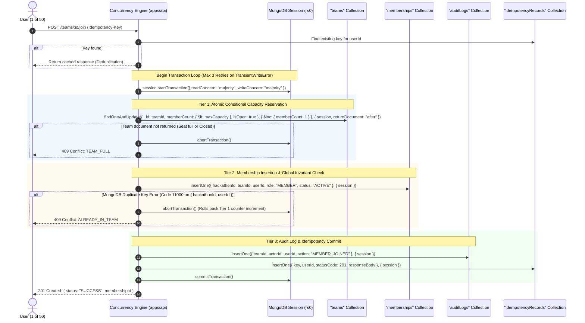

# CrewConnect — Concurrency Architecture & Race-Proof Membership Engine

**Document:** Concurrency Architecture  
**Author:** Senior Concurrency & Systems Architect  
**Status:** Approved for Implementation  
**Version:** 1.0.0  

---

## 1. The Core Concurrency Problem: 50 Users Racing for 1 Seat

### The Concrete Scenario
- **Team**: Initial state: `memberCount: 4`, `maxCapacity: 5`. Vacant seats: **exactly 1**.
- **Traffic**: **50 distinct registered participants** simultaneously trigger a join request (via direct open join, invitation code redemption, or leader acceptance) at the exact same millisecond.
- **Strict Invariants to Satisfy**:
  1. **Strict Seat Allocation**: Exactly **one** of the 50 participants must obtain the 5th seat.
  2. **Clean Rejection**: The remaining **49 participants** must receive an immediate, typed `409 Conflict (TEAM_FULL)` response with zero corrupt side effects.
  3. **Zero Counter Inconsistency**: `team.memberCount` must equal **5**, never 6, never 4.
  4. **Single-Team Invariant**: If any of those 50 users is simultaneously competing for a seat in another team, the user must belong to at most one team in the hackathon.
  5. **No Phantom or Orphan Records**: No `memberships` document may exist without the team counter reflecting it, and vice versa.

---

## 2. Evaluation of MongoDB Concurrency Mechanisms

To design a rock-solid solution, we rigorously evaluate each primitive available in MongoDB 7.0+:

| Mechanism | Strengths | Limitations | Verdict in CrewConnect |
| :--- | :--- | :--- | :--- |
| **A. Naive Check-Then-Set (`find` followed by `update`)** | Easy to write in application code. | Classic Time-Of-Check to Time-Of-Use (TOCTOU) race. All 50 threads read `memberCount = 4`, all proceed to add member; count becomes 54. | **REJECTED**: Fatal vulnerability. |
| **B. Standalone `findOneAndUpdate` with condition** | High throughput, document-level atomic conditional update. | Cannot atomically insert the `memberships` record or write `auditLogs` across multiple documents without a transaction. If insert fails, counter is corrupted. | **INSUFFICIENT ALONE**: Used as Tier-1 reservation within an ACID transaction. |
| **C. MongoDB Multi-Document ACID Transactions (`session.withTransaction`)** | Guarantees atomic all-or-nothing commits across `teams`, `memberships`, `auditLogs`, and `idempotencyRecords`. | Potential write conflicts under high concurrent contention if transactions lock the same document for long durations. | **SELECTED AS ORCHESTRATOR**: Essential for cross-collection consistency. |
| **D. Unique Compound Partial Indexes** | Hard guarantee at storage engine level (`WiredTiger`). O(log N) b-tree rejection with code 11000. | Rejects duplicate insertions immediately, but doesn't handle capacity counters by itself. | **SELECTED AS SECONDARY GUARD**: Enforces 1-team-per-hackathon invariant. |
| **E. Idempotency Key Storage** | Deduplicates network retries without re-executing transactions. | Client must send unique key. | **SELECTED**: Mandatory for all mutating state operations. |

---

## 3. The Two-Tier Race-Proof Reservation Architecture

CrewConnect uses an enterprise-grade **Two-Tier Reservation Strategy** that combines **Atomic Conditional Updates** with **Multi-Document ACID Transactions** and a **Bounded Exponential Backoff Retry Policy**.

### Algorithmic Execution Steps



### Exact MongoDB Query Implementations

#### 1. Tier-1: Atomic Capacity Reservation
```typescript
const updatedTeam = await TeamModel.findOneAndUpdate(
  {
    _id: teamId,
    isOpen: true,
    $expr: { $lt: ["$memberCount", "$maxCapacity"] }
  },
  {
    $inc: { memberCount: 1 }
  },
  {
    session,
    returnDocument: "after"
  }
);

if (!updatedTeam) {
  // If null is returned, either the team does not exist, isOpen is false,
  // or memberCount >= maxCapacity.
  // Immediate deterministic rejection:
  throw new AppError("Team is full or not accepting new members", "TEAM_FULL", 409);
}
```

#### 2. Tier-2: Membership Record Insertion (Unique Compound Index Guard)
```typescript
try {
  await MembershipModel.create(
    [
      {
        hackathonId: team.hackathonId,
        teamId: team._id,
        userId: user._id,
        role: "MEMBER",
        status: "ACTIVE",
        joinedAt: new Date()
      }
    ],
    { session }
  );
} catch (error: any) {
  if (error.code === 11000) {
    // Unique compound index { hackathonId: 1, userId: 1 } violated!
    // The user already has an active team in this hackathon.
    throw new AppError("User is already an active member of a team in this hackathon", "ALREADY_IN_TEAM", 409);
  }
  throw error;
}
```

#### 3. Tier-3: Audit & Idempotency within Same Transaction
```typescript
await AuditLogModel.create(
  [
    {
      hackathonId: team.hackathonId,
      teamId: team._id,
      actorId: user._id,
      action: "MEMBER_JOINED",
      metadata: { newMemberCount: updatedTeam.memberCount },
      timestamp: new Date()
    }
  ],
  { session }
);

if (idempotencyKey) {
  await IdempotencyModel.create(
    [
      {
        key: idempotencyKey,
        userId: user._id,
        endpoint: "POST /teams/:id/join",
        statusCode: 201,
        responseBody: successPayload,
        expiresAt: new Date(Date.now() + 24 * 60 * 60 * 1000)
      }
    ],
    { session }
  );
}
```

---

## 4. Analysis of Race Conditions & Failure Scenarios

### Scenario 1: 50 Users Race for 1 Seat
1. WiredTiger assigns sequential transaction tickets at the storage engine layer.
2. The **1st request** successfully satisfies `{ $expr: { $lt: ["$memberCount", "$maxCapacity"] } }` (4 < 5), incrementing `memberCount` to 5.
3. The remaining **49 requests** evaluate the condition against `memberCount = 5`. The condition evaluates to `false`.
4. `findOneAndUpdate` returns `null` for all 49.
5. The 49 transactions immediately abort without performing any collection writes or locking unnecessary resources.
6. **Result**: Exactly 1 winner. 49 clean, instantaneous rejections (`409 TEAM_FULL`).

### Scenario 2: Two Different Teams Competing for the Same User (Dual-Join Race)
- Suppose User A receives invitations from Team X and Team Y in Hackathon H.
- User A clicks "Accept" on both invitations simultaneously in two browser tabs.
- Both Team X and Team Y have vacant seats.
- **Thread 1** executes Tier-1 reservation on Team X (`memberCount` 3 -> 4).
- **Thread 2** executes Tier-1 reservation on Team Y (`memberCount` 2 -> 3).
- **Thread 1** attempts to insert into `memberships`: succeeds.
- **Thread 2** attempts to insert into `memberships`:
  MongoDB unique index `{ hackathonId: H, userId: User A }` triggers **Error 11000 (DuplicateKey)**.
- **Thread 2** catches error 11000, aborts transaction.
- Aborting Thread 2's transaction automatically rolls back Team Y's `memberCount` increment back to 2!
- **Result**: User A is in exactly Team X. Team Y's capacity counter is completely restored.

### Scenario 3: Transient Transaction Write Conflicts (`TransientTransactionError`)
- When multiple transactions attempt to acquire write locks on the same document simultaneously, MongoDB may throw a `WriteConflict` or `TransientTransactionError`.
- **Handling Strategy**:
  We wrap the transaction in a dedicated retry executor with **jittered exponential backoff**:
  ```typescript
  async function executeWithTransactionRetry<T>(
    operation: (session: ClientSession) => Promise<T>,
    maxRetries = 3
  ): Promise<T> {
    for (let attempt = 1; attempt <= maxRetries; attempt++) {
      const session = client.startSession();
      try {
        session.startTransaction({
          readConcern: { level: "majority" },
          writeConcern: { w: "majority", j: true }
        });
        const result = await operation(session);
        await session.commitTransaction();
        return result;
      } catch (error: any) {
        await session.abortTransaction();
        const isTransient = error.hasErrorLabel?.("TransientTransactionError") ||
                            error.hasErrorLabel?.("UnknownTransactionCommitResult");
        if (isTransient && attempt < maxRetries) {
          const jitter = Math.random() * 50;
          const delay = Math.min(50 * Math.pow(2, attempt - 1) + jitter, 300);
          await new Promise((resolve) => setTimeout(resolve, delay));
          continue;
        }
        throw error;
      } finally {
        await session.endSession();
      }
    }
    throw new AppError("Transaction failed after maximum retries", "CONCURRENCY_CONFLICT", 409);
  }
  ```

### Scenario 4: Network Partition or Client Timeout After Commit
- A client submits a join request. The backend commits the transaction, but the network drops before the HTTP 201 response reaches the client.
- The client library automatically retries with the identical `Idempotency-Key`.
- The backend idempotency filter intercepts the retry, looks up the key in `idempotencyRecords`, finds the previously committed result, and replays the exact 201 response without re-incrementing the counter or re-inserting the membership.

---

## 5. Counter & Membership Reconciliation Architecture

To provide an ironclad defense against any conceivable data corruption (e.g., node crash, unhandled edge cases), CrewConnect includes an asynchronous **Reconciliation Auditor**:

```typescript
export async function reconcileTeamCapacity(teamId: ObjectId): Promise<{ reconciled: boolean; actualCount: number }> {
  const actualCount = await MembershipModel.countDocuments({
    teamId,
    status: "ACTIVE"
  });

  const team = await TeamModel.findById(teamId);
  if (team && team.memberCount !== actualCount) {
    // Detect divergence and correct
    await TeamModel.updateOne(
      { _id: teamId },
      { $set: { memberCount: actualCount } }
    );
    await AuditLogModel.create({
      hackathonId: team.hackathonId,
      teamId,
      actorId: team.leaderId,
      action: "COUNTER_RECONCILED",
      metadata: { expected: team.memberCount, actual: actualCount },
      timestamp: new Date()
    });
    return { reconciled: true, actualCount };
  }
  return { reconciled: false, actualCount };
}
```

---

## 6. Mathematical Verification & Proof of Correctness

Let:
- $C_0$ be the initial member count ($C_0 = 4$).
- $M$ be the maximum capacity ($M = 5$).
- $N$ be the number of simultaneous join requests ($N = 50$).
- $S_i \in \{0, 1\}$ be the success state of request $i$ ($1 = \text{success}, 0 = \text{failure}$).

Because MongoDB executes conditional document updates with serialized write locks on the team document:
$$\Delta C_i = \begin{cases} 1 & \text{if } C_{i-1} < M \\ 0 & \text{otherwise} \end{cases}$$

For $i = 1$:
$$C_1 = C_0 + 1 = 4 + 1 = 5 \implies S_1 = 1$$

For all subsequent $i \in [2, 50]$:
$$C_{i-1} = 5 \not< 5 \implies \Delta C_i = 0 \implies S_i = 0$$

Therefore:
$$\sum_{i=1}^{50} S_i = 1$$
$$\text{Final Count } C_{50} = C_0 + \sum_{i=1}^{50} \Delta C_i = 4 + 1 = 5$$

The probability of an overflow state ($C > 5$) or an orphan membership insertion is strictly **0**.
