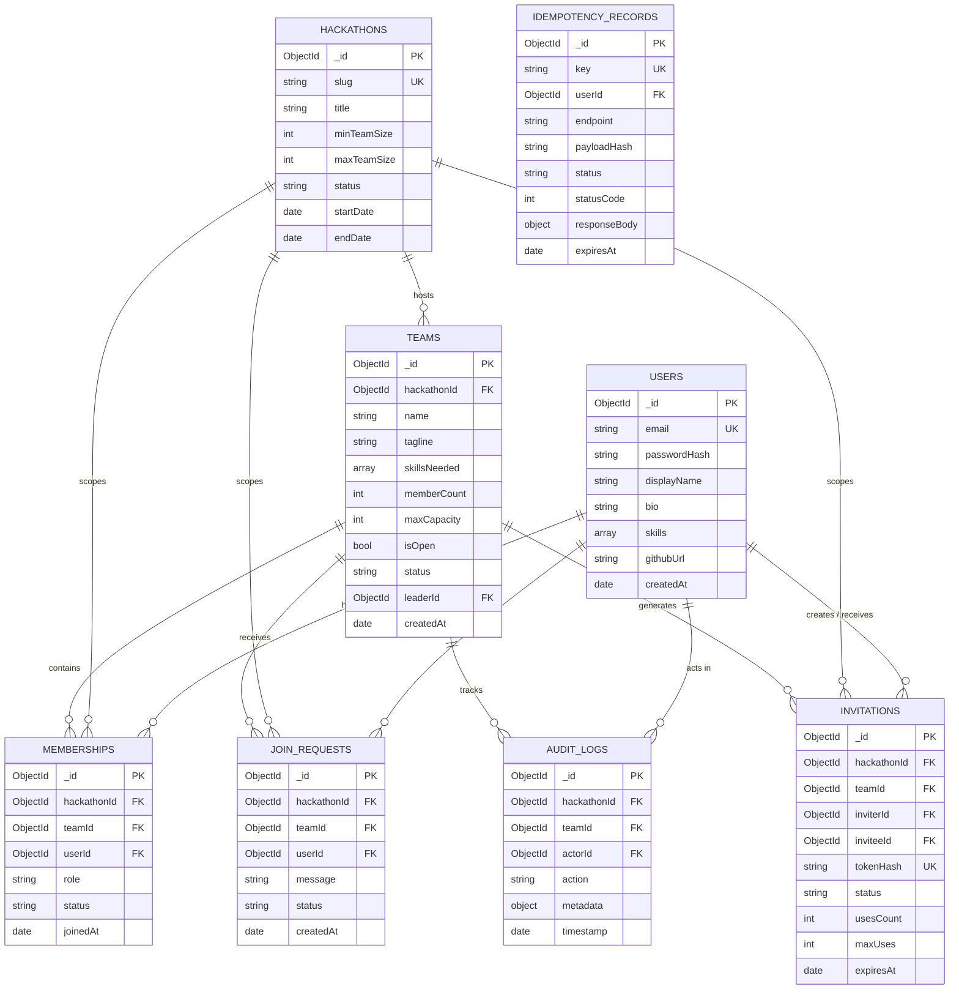

# CrewConnect — MongoDB Data Model Design & Schema Specification

**Document:** Database Design & Data Modeling  
**Author:** Senior Database Architect  
**Status:** Finalized & Approved  
**Version:** 1.1.0  

---

## 1. Architectural Modeling Decision: Dedicated Collection vs. Embedded Array

A pivotal design decision in MongoDB is choosing between embedding members inside the `teams` document vs. storing them in a dedicated `memberships` collection.

### Option A: Embedded Members Array (`team.members = [{ userId, role, joinedAt }]`)
* **Pros**: Reading a team and its full member list requires only a single document fetch (no joins/`$lookup`).
* **Fatal Flaws**:
  1. **Global Invariant Breach**: MongoDB cannot enforce a cross-document uniqueness constraint on array subfields. If User A submits two concurrent requests to join Team 1 and Team 2 in the same hackathon, two different team documents would be modified in parallel. Without a cross-document unique index, User A would successfully join both teams, violating Invariant 1 (**One team per user per hackathon**).
  2. **Document Growth & Fragmentation**: Frequent additions/removals cause document reallocation on disk.
  3. **High Write Contention**: Every team activity (member join, status update, profile edit) locks the same team document.

### Option B (Selected): Dedicated `memberships` Collection with Cached `memberCount`
* **Architecture**: Team membership is modeled as a first-class document in `memberships`. The `teams` document maintains a cached counter `memberCount` for low-latency queries and atomic conditional reservations.
* **Why This Wins**:
  1. **Unbreakable Global Constraint**: A database-level unique compound index on `memberships`:
     ```json
     { "hackathonId": 1, "userId": 1 } (unique: true, partialFilterExpression: { status: "ACTIVE" })
     ```
     guarantees that no user can ever belong to more than one team in the same hackathon. Even if concurrent transactions slip past the application layer, the database engine enforces serialization and rejects duplicates with error code 11000.
  2. **Reduced Lock Contention**: Member profile lookups and status updates don't lock the team document.
  3. **Auditability & Historic Tracking**: Soft deletions or historical status (`ACTIVE`, `LEFT`, `REMOVED`) can be maintained without bloating the team document.

---

## 2. Entity Relationship Diagram (ERD)



---

## 3. Detailed Collection Schemas & Invariant Rules

### 1. `users`
Represents registered platform participants.
- `_id`: `ObjectId` (Primary Key)
- `email`: `String` (Required, Lowercase, Trimmed, Unique)
- `passwordHash`: `String` (Required, Argon2id hashed password with salt)
- `displayName`: `String` (Required, 2–50 chars)
- `bio`: `String` (Optional, max 500 chars)
- `skills`: `Array<String>` (Required, indexed for matchmaking)
- `experienceLevel`: `String` (Optional: `"BEGINNER" | "INTERMEDIATE" | "ADVANCED"`)
- `githubUrl`: `String` (Optional, URL format)
- `linkedinUrl`: `String` (Optional, URL format)
- `portfolioUrl`: `String` (Optional, URL format)
- `createdAt`: `Date` (Required, default `now`)
- `updatedAt`: `Date` (Required, default `now`)

**Indexes:**
- `{ email: 1 }` (unique: true)
- `{ skills: 1 }` (multikey index for recommendation queries)

---

### 2. `hackathons`
Defines the boundary and capacity limits for an event.
- `_id`: `ObjectId` (Primary Key)
- `slug`: `String` (Required, Unique, e.g. `"hack4hack-2026"`)
- `title`: `String` (Required, 3–100 chars)
- `description`: `String` (Required)
- `minTeamSize`: `Number` (Required, default `1`, min `1`)
- `maxTeamSize`: `Number` (Required, default `5`, max `10`)
- `status`: `String` (Required, enum: `["UPCOMING", "ACTIVE", "COMPLETED"]`)
- `startDate`: `Date` (Required)
- `endDate`: `Date` (Required)
- `createdAt`: `Date` (Required)

**Indexes:**
- `{ slug: 1 }` (unique: true)
- `{ status: 1, startDate: 1 }` (for active hackathon queries)

---

### 3. `teams`
Represents a formed team competing in a specific hackathon.
- `_id`: `ObjectId` (Primary Key)
- `hackathonId`: `ObjectId` (Required, References `hackathons._id`)
- `name`: `String` (Required, 2–50 chars, trimmed)
- `tagline`: `String` (Optional, max 100 chars)
- `description`: `String` (Optional, max 1000 chars)
- `skillsNeeded`: `Array<String>` (Indexed array of required technical skills)
- `memberCount`: `Number` (Required, cached active count, range: `0` to `maxCapacity`)
- `maxCapacity`: `Number` (Required, default `5`)
- `isOpen`: `Boolean` (Required, default `true`, whether team is open to direct joins/requests)
- `status`: `String` (Required, enum: `["ACTIVE", "DISBANDED", "ARCHIVED"]`, default `"ACTIVE"`)
- `leaderId`: `ObjectId` (Required, References `users._id` of the current active team leader)
- `createdAt`: `Date` (Required)
- `updatedAt`: `Date` (Required)

**Leadership & Team Lifecycle Invariants:**
1. **Leader Must Be Active Member**: `teams.leaderId` must always reference a user who possesses an active record in `memberships` with `role: "LEADER"` and `status: "ACTIVE"`.
2. **Leader Departure Protection**: The leader cannot leave (`/leave`) or be removed (`/members/:id`) without first executing a leadership transfer (`/transfer-leadership`) to another active member, or explicitly disbanding the team.
3. **Disbandment on Last Member Departure**: When the last remaining member leaves or is removed, the team atomically transitions to `status: "DISBANDED"`, `isOpen: false`, and `memberCount: 0`. Disbanded teams cannot be joined.

**Indexes:**
- `{ hackathonId: 1, status: 1, isOpen: 1, memberCount: 1 }` (Composite index for Team Discovery Board)
- `{ hackathonId: 1, name: 1 }` (Unique compound index per hackathon)
- `{ hackathonId: 1, skillsNeeded: 1 }` (Multikey index for skill-based search)
- `{ leaderId: 1 }` (Leader active team lookup)

---

### 4. `memberships`
Represents the active or historical association between a user and a team within a hackathon.
- `_id`: `ObjectId` (Primary Key)
- `hackathonId`: `ObjectId` (Required, References `hackathons._id`)
- `teamId`: `ObjectId` (Required, References `teams._id`)
- `userId`: `ObjectId` (Required, References `users._id`)
- `role`: `String` (Required, enum: `["LEADER", "MEMBER"]`, default `"MEMBER"`)
- `status`: `String` (Required, enum: `["ACTIVE", "LEFT", "REMOVED"]`, default `"ACTIVE"`)
- `joinedAt`: `Date` (Required, default `now`)
- `leftAt`: `Date` (Optional, set when departing or removed)

**Critical Indexes:**
- `{ hackathonId: 1, userId: 1 }` (**Unique compound partial index**: `unique: true, partialFilterExpression: { status: "ACTIVE" }`)
  - *Hard Invariant Guaranteed*: A user can have at most one active membership across all teams in the same hackathon.
- `{ teamId: 1, status: 1 }` (For listing current team members and reconciling counter)
- `{ userId: 1, status: 1 }` (For instant user dashboard lookup)

---

### 5. `joinRequests`
Tracks requests from solo participants seeking to join open teams.
- `_id`: `ObjectId` (Primary Key)
- `hackathonId`: `ObjectId` (Required, References `hackathons._id`)
- `teamId`: `ObjectId` (Required, References `teams._id`)
- `userId`: `ObjectId` (Required, References `users._id`)
- `message`: `String` (Optional, max 300 chars)
- `status`: `String` (Required, enum: `["PENDING", "APPROVED", "REJECTED", "CANCELLED"]`, default `"PENDING"`)
- `createdAt`: `Date` (Required, default `now`)
- `resolvedAt`: `Date` (Optional)
- `resolvedBy`: `ObjectId` (Optional, References `users._id`)

**Indexes:**
- `{ teamId: 1, status: 1 }` (Listing pending requests for team)
- `{ hackathonId: 1, userId: 1, status: 1 }` (Listing pending requests submitted by user)
- `{ teamId: 1, userId: 1 }` (Preventing duplicate pending requests to same team)

---

### 6. `invitations`
Supports secret alphanumeric invite codes as well as direct user invitations.
- `_id`: `ObjectId` (Primary Key)
- `hackathonId`: `ObjectId` (Required, References `hackathons._id`)
- `teamId`: `ObjectId` (Required, References `teams._id`)
- `inviterId`: `ObjectId` (Required, References `users._id` of the leader)
- `inviteeId`: `ObjectId` (Optional, for targeted direct invites; null for open invite codes)
- `tokenHash`: `String` (Required, SHA-256 hash of the generated secret code, Unique)
- `status`: `String` (Required, enum: `["ACTIVE", "EXPIRED", "REVOKED", "EXHAUSTED"]`, default `"ACTIVE"`)
- `usesCount`: `Number` (Required, default `0`, incremented atomically upon redemption)
- `maxUses`: `Number` (Required, default `1`, max redemptions allowed for this code)
- `expiresAt`: `Date` (Required, expiration timestamp)
- `createdAt`: `Date` (Required, default `now`)

**Indexes:**
- `{ tokenHash: 1 }` (unique: true — Fast O(1) secret lookup)
- `{ teamId: 1, status: 1 }` (Team active invitation lookup)
- `{ inviteeId: 1, status: 1 }` (User direct invitation inbox)

---

### 7. `auditLogs`
Immutable record of all security and team composition actions.
- `_id`: `ObjectId` (Primary Key)
- `hackathonId`: `ObjectId` (Required, References `hackathons._id`)
- `teamId`: `ObjectId` (Optional, References `teams._id`)
- `actorId`: `ObjectId` (Required, References `users._id` who initiated the action)
- `targetUserId`: `ObjectId` (Optional, References `users._id` affected by the action)
- `action`: `String` (Required, enum: `["TEAM_CREATED", "TEAM_DISBANDED", "MEMBER_JOINED", "MEMBER_LEFT", "MEMBER_REMOVED", "LEADERSHIP_TRANSFERRED", "INVITE_CREATED", "INVITE_REDEEMED", "JOIN_REQUEST_SUBMITTED", "JOIN_REQUEST_APPROVED"]`)
- `metadata`: `Object` (Required, contextual data such as IP address, user agent, old/new counts)
- `timestamp`: `Date` (Required, default `now`)

**Indexes:**
- `{ teamId: 1, timestamp: -1 }` (Team activity feed ordered newest first)
- `{ actorId: 1, timestamp: -1 }` (User activity log)
- `{ hackathonId: 1, timestamp: -1 }` (Hackathon compliance audit)

---

### 8. `idempotencyRecords`
Guarantees duplicate-safe retries and prevents parallel in-flight race conditions for state-mutating requests.
- `_id`: `ObjectId` (Primary Key)
- `key`: `String` (Required, UUIDv4 sent in `Idempotency-Key` header)
- `userId`: `ObjectId` (Required, References `users._id`)
- `endpoint`: `String` (Required, e.g. `"POST /api/v1/teams/:id/join"`)
- `payloadHash`: `String` (Required, SHA-256 hash of the request body to detect payload mismatches)
- `status`: `String` (Required, enum: `["PROCESSING", "COMPLETED", "FAILED"]`, default `"PROCESSING"`)
- `statusCode`: `Number` (Optional, populated on completion, e.g. `201`, `409`)
- `responseBody`: `Object` (Optional, exact JSON response payload returned)
- `createdAt`: `Date` (Required, default `now`)
- `expiresAt`: `Date` (Required, TTL index for eventual cleanup only)

**Idempotency Invariant & TTL Clarification:**
1. **User & Endpoint Scoping**: The compound index `{ key: 1, userId: 1, endpoint: 1 }` is strictly unique. An idempotency key is tied to the authenticated user and operation route.
2. **In-Flight Lock**: If a concurrent request arrives with the same key while `status == "PROCESSING"`, it is rejected with `409 Conflict (REQUEST_IN_PROGRESS)` to eliminate parallel race execution.
3. **Payload Verification**: If a subsequent request reuses an existing key with a different request payload, the system detects `payloadHash !== existing.payloadHash` and rejects with `409 Conflict (IDEMPOTENCY_KEY_PAYLOAD_MISMATCH)`.
4. **Transaction Consistency**: If the transaction fails, the record is marked `FAILED` or removed. Failed transactions never leave misleading `COMPLETED` records.
5. **Role of TTL**: The MongoDB TTL index (`expireAfterSeconds: 0` on `expiresAt`) is solely for **eventual database storage reclamation** (e.g. purging 24-hour-old keys), **NOT for correctness**. Correctness is strictly enforced by the database transaction and unique index.

**Indexes:**
- `{ key: 1, userId: 1, endpoint: 1 }` (unique: true — Scoped idempotency constraint)
- `{ expiresAt: 1 }` (expireAfterSeconds: 0 — Eventual storage cleanup)
