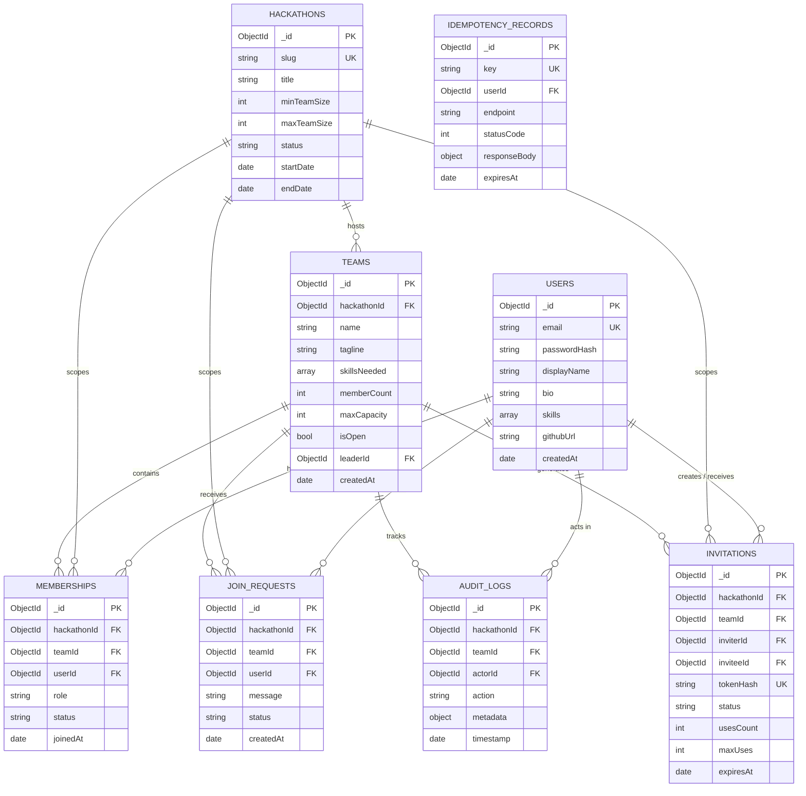

# CrewConnect — MongoDB Data Model Design & Schema Specification

**Document:** Database Design & Data Modeling  
**Author:** Senior Database Architect  
**Status:** Approved for Implementation  
**Version:** 1.0.0  

---

## 1. Architectural Modeling Decision: Dedicated Collection vs. Embedded Array

A pivotal design decision in MongoDB is choosing between embedding members inside the `teams` document vs. storing them in a dedicated `memberships` collection.

### Option A: Embedded Members Array (`team.members = [{ userId, role, joinedAt }]`)
* **Pros**: Reading a team and its full member list requires only a single document fetch (no joins/`$lookup`).
* **Fatal Flaws**:
  1. **Global Invariant Breach**: MongoDB cannot enforce a cross-document uniqueness constraint on array subfields. If User A submits two concurrent requests to join Team 1 and Team 2 in the same hackathon, two different team documents would be modified in parallel. Without a cross-document unique index, User A would successfully join both teams, violating Invariant 1 (**One team per user per hackathon**).
  2. **Document Growth & Fragmentation**: Frequent additions/removals cause document reallocation on disk.
  3. **High Write Contention**: Every team activity (member join, status update, profile edit) locks the same team document.

### Option B (Selected): Dedicated `memberships` Collection with Cached `memberCount`
* **Architecture**: Team membership is modeled as a first-class document in `memberships`. The `teams` document maintains a cached counter `memberCount` for low-latency queries and atomic conditional reservations.
* **Why This Wins**:
  1. **Unbreakable Global Constraint**: A database-level unique compound index on `memberships`:
     ```json
     { "hackathonId": 1, "userId": 1 } (unique: true)
     ```
     guarantees that no user can ever belong to more than one team in the same hackathon. Even if concurrent transactions slip past the application layer, the database engine enforces serialization and rejects duplicates with error code 11000.
  2. **Reduced Lock Contention**: Member profile lookups and status updates don't lock the team document.
  3. **Auditability & Historic Tracking**: Soft deletions or historical status (`ACTIVE`, `LEFT`, `REMOVED`) can be maintained without bloating the team document.

---

## 2. Entity Relationship Diagram (ERD)



---

## 3. Detailed Collection Schemas & Specifications

### 1. `users`
Represents registered platform participants.
- `_id`: `ObjectId` (Primary Key)
- `email`: `String` (Required, Lowercase, Trimmed, Unique)
- `passwordHash`: `String` (Required, Argon2id/bcrypt hashed password)
- `displayName`: `String` (Required, 2–50 chars)
- `bio`: `String` (Optional, max 500 chars)
- `skills`: `Array<String>` (Required, indexed for matchmaking, e.g. `["React", "Node.js"]`)
- `experienceLevel`: `String` (Optional: `"BEGINNER" | "INTERMEDIATE" | "ADVANCED"`)
- `githubUrl`: `String` (Optional, URL format)
- `linkedinUrl`: `String` (Optional, URL format)
- `portfolioUrl`: `String` (Optional, URL format)
- `createdAt`: `Date` (Required, default `now`)
- `updatedAt`: `Date` (Required, default `now`)

**Indexes:**
- `{ email: 1 }` (unique: true)
- `{ skills: 1 }` (multikey index for teammate recommendation filtering)

---

### 2. `hackathons`
Defines the boundary and capacity limits for an event.
- `_id`: `ObjectId` (Primary Key)
- `slug`: `String` (Required, Unique, e.g. `"hack4hack-2026"`)
- `title`: `String` (Required, 3–100 chars)
- `description`: `String` (Required)
- `minTeamSize`: `Number` (Required, default `1`, min `1`)
- `maxTeamSize`: `Number` (Required, default `5`, max `10`)
- `status`: `String` (Required, enum: `["UPCOMING", "ACTIVE", "COMPLETED"]`)
- `startDate`: `Date` (Required)
- `endDate`: `Date` (Required)
- `createdAt`: `Date` (Required)

**Indexes:**
- `{ slug: 1 }` (unique: true)
- `{ status: 1, startDate: 1 }` (for listing active/upcoming events)

---

### 3. `teams`
Represents a formed team competing in a specific hackathon.
- `_id`: `ObjectId` (Primary Key)
- `hackathonId`: `ObjectId` (Required, References `hackathons._id`)
- `name`: `String` (Required, 2–50 chars, trimmed)
- `tagline`: `String` (Optional, max 100 chars)
- `description`: `String` (Optional, max 1000 chars)
- `skillsNeeded`: `Array<String>` (Indexed array of required technical skills)
- `memberCount`: `Number` (Required, cached active count, range: `1` to `maxCapacity`)
- `maxCapacity`: `Number` (Required, derived from hackathon `maxTeamSize`, default `5`)
- `isOpen`: `Boolean` (Required, default `true`, whether team is open to direct joins/requests)
- `leaderId`: `ObjectId` (Required, References `users._id` of the current active team leader)
- `createdAt`: `Date` (Required)
- `updatedAt`: `Date` (Required)

**Indexes:**
- `{ hackathonId: 1, isOpen: 1, memberCount: 1 }` (Composite index for Team Discovery Board)
- `{ hackathonId: 1, name: 1 }` (Unique compound index per hackathon to prevent duplicate team names)
- `{ hackathonId: 1, skillsNeeded: 1 }` (Multikey compound index for skill-based discovery search)
- `{ leaderId: 1 }` (Index for leader queries)

---

### 4. `memberships`
Represents the active or historical association between a user and a team within a hackathon.
- `_id`: `ObjectId` (Primary Key)
- `hackathonId`: `ObjectId` (Required, References `hackathons._id`)
- `teamId`: `ObjectId` (Required, References `teams._id`)
- `userId`: `ObjectId` (Required, References `users._id`)
- `role`: `String` (Required, enum: `["LEADER", "MEMBER"]`, default `"MEMBER"`)
- `status`: `String` (Required, enum: `["ACTIVE", "LEFT", "REMOVED"]`, default `"ACTIVE"`)
- `joinedAt`: `Date` (Required, default `now`)
- `leftAt`: `Date` (Optional, set when departing or removed)

**Critical Indexes:**
- `{ hackathonId: 1, userId: 1 }` (**Unique compound partial index**: `unique: true, partialFilterExpression: { status: "ACTIVE" }`)
  - *Invariant Guaranteed*: Exactly one active membership per user per hackathon across all teams.
- `{ teamId: 1, status: 1 }` (For listing current team members and reconciling counter)
- `{ userId: 1, status: 1 }` (For instant user dashboard lookup)

---

### 5. `joinRequests`
Tracks requests from solo participants seeking to join open teams.
- `_id`: `ObjectId` (Primary Key)
- `hackathonId`: `ObjectId` (Required, References `hackathons._id`)
- `teamId`: `ObjectId` (Required, References `teams._id`)
- `userId`: `ObjectId` (Required, References `users._id`)
- `message`: `String` (Optional, max 300 chars)
- `status`: `String` (Required, enum: `["PENDING", "APPROVED", "REJECTED", "CANCELLED"]`, default `"PENDING"`)
- `createdAt`: `Date` (Required, default `now`)
- `resolvedAt`: `Date` (Optional)
- `resolvedBy`: `ObjectId` (Optional, References `users._id`)

**Indexes:**
- `{ teamId: 1, status: 1 }` (Leader inbox: listing pending requests for team)
- `{ hackathonId: 1, userId: 1, status: 1 }` (User view: listing pending requests submitted by user)
- `{ teamId: 1, userId: 1 }` (Preventing duplicate pending requests to same team)

---

### 6. `invitations`
Supports secret alphanumeric invite codes as well as direct user invitations.
- `_id`: `ObjectId` (Primary Key)
- `hackathonId`: `ObjectId` (Required, References `hackathons._id`)
- `teamId`: `ObjectId` (Required, References `teams._id`)
- `inviterId`: `ObjectId` (Required, References `users._id` of the leader)
- `inviteeId`: `ObjectId` (Optional, for targeted direct invites; null for open invite codes)
- `tokenHash`: `String` (Required, SHA-256 hash of the generated secret code, Unique)
- `status`: `String` (Required, enum: `["ACTIVE", "EXPIRED", "REVOKED", "EXHAUSTED"]`, default `"ACTIVE"`)
- `usesCount`: `Number` (Required, default `0`, incremented atomically upon redemption)
- `maxUses`: `Number` (Required, default `1`, max redemptions allowed for this code)
- `expiresAt`: `Date` (Required, TTL expiration timestamp)
- `createdAt`: `Date` (Required, default `now`)

**Indexes:**
- `{ tokenHash: 1 }` (unique: true — Fast O(1) secret lookup)
- `{ teamId: 1, status: 1 }` (Team active invitation lookup)
- `{ inviteeId: 1, status: 1 }` (User direct invitation inbox)
- `{ expiresAt: 1 }` (MongoDB TTL index for automatic expiry cleanup or status transition)

---

### 7. `auditLogs`
Immutable record of all security and team composition actions.
- `_id`: `ObjectId` (Primary Key)
- `hackathonId`: `ObjectId` (Required, References `hackathons._id`)
- `teamId`: `ObjectId` (Optional, References `teams._id`)
- `actorId`: `ObjectId` (Required, References `users._id` who initiated the action)
- `targetUserId`: `ObjectId` (Optional, References `users._id` affected by the action)
- `action`: `String` (Required, enum: `["TEAM_CREATED", "MEMBER_JOINED", "MEMBER_LEFT", "MEMBER_REMOVED", "LEADERSHIP_TRANSFERRED", "INVITE_CREATED", "INVITE_REDEEMED", "JOIN_REQUEST_SUBMITTED", "JOIN_REQUEST_APPROVED"]`)
- `metadata`: `Object` (Required, contextual data such as IP address, user agent, old/new counts)
- `timestamp`: `Date` (Required, default `now`)

**Indexes:**
- `{ teamId: 1, timestamp: -1 }` (Team activity feed ordered newest first)
- `{ actorId: 1, timestamp: -1 }` (User activity log)
- `{ hackathonId: 1, timestamp: -1 }` (Hackathon global compliance audit)

---

### 8. `idempotencyRecords`
Guarantees duplicate-safe retries for mutating operations.
- `_id`: `ObjectId` (Primary Key)
- `key`: `String` (Required, Unique UUIDv4 string sent in `Idempotency-Key` header)
- `userId`: `ObjectId` (Required, References `users._id`)
- `endpoint`: `String` (Required, e.g. `"POST /api/v1/teams/:id/join"`)
- `statusCode`: `Number` (Required, e.g. `201`, `409`)
- `responseBody`: `Object` (Required, exact JSON payload returned)
- `createdAt`: `Date` (Required, default `now`)
- `expiresAt`: `Date` (Required, TTL index, expires after 24 hours)

**Indexes:**
- `{ key: 1, userId: 1 }` (unique: true — Scoped to user to prevent cross-tenant collision)
- `{ expiresAt: 1 }` (expireAfterSeconds: 0 — Automatic MongoDB TTL cleanup)

---

## 4. Query & Index Strategy Matrix

| Query Use-Case | Target Collection | Primary Filter / Sort | Recommended Index | Covered Query? |
| :--- | :--- | :--- | :--- | :--- |
| **Team Discovery Board** | `teams` | `hackathonId = X, isOpen = true`, sort by `createdAt -1` | `{ hackathonId: 1, isOpen: 1, createdAt: -1 }` | Yes |
| **Skill Filter Search** | `teams` | `hackathonId = X, skillsNeeded in [Y, Z]` | `{ hackathonId: 1, skillsNeeded: 1 }` | Yes |
| **User Current Team** | `memberships` | `hackathonId = X, userId = Y, status = 'ACTIVE'` | `{ hackathonId: 1, userId: 1 }` (unique partial) | Yes |
| **Team Active Roster** | `memberships` | `teamId = X, status = 'ACTIVE'` | `{ teamId: 1, status: 1 }` | Yes |
| **Pending Join Requests**| `joinRequests` | `teamId = X, status = 'PENDING'` | `{ teamId: 1, status: 1 }` | Yes |
| **Invite Token Lookup** | `invitations` | `tokenHash = H(token)` | `{ tokenHash: 1 }` (unique) | Yes |
| **Team Audit Trail** | `auditLogs` | `teamId = X`, sort `timestamp -1` | `{ teamId: 1, timestamp: -1 }` | Yes |
