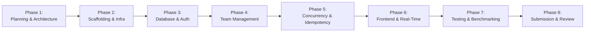

# CrewConnect — Comprehensive Implementation Roadmap

**Document:** Implementation Roadmap & Phase Execution Plan  
**Author:** Technical Lead & Engineering Project Planner  
**Status:** Approved for Implementation  
**Version:** 1.0.0  

---

## 1. Roadmap Overview & Timeline

The CrewConnect engineering lifecycle is organized into eight distinct, sequential, quality-gated phases to guarantee concurrency correctness, maintainability, and delivery excellence:

---

## 2. Phase-by-Phase Execution Plan

### Phase 1: Planning, Architecture & Repository Foundation *(Current Phase)*
- **Scope**:
  - Environment inspection, skills evaluation, and Git repository initialization.
  - Complete requirements analysis and Requirements Traceability Matrix.
  - End-to-end architecture, database schema, concurrency, API, security, and testing designs.
  - Architecture Decision Records (ADRs) capturing core technical choices.
  - Root monorepo scaffolding (`package.json`, `.gitignore`, `.editorconfig`, `.env.example`, READMEs).
- **Dependencies**: None.
- **Deliverables**:
  - Initialized Git repository on `main` branch.
  - Monorepo directory structure.
  - All documents in `docs/`: `requirements.md`, `architecture.md`, `database-design.md`, `concurrency-design.md`, `api-specification.md`, `security-design.md`, `testing-strategy.md`, `implementation-roadmap.md`, `adr/README.md`, ADRs 0001–0005.
- **Acceptance Criteria**:
  - Clean repository with zero committed secrets.
  - All architecture and design documents complete and mutually consistent.
  - Zero application code prematurely implemented.
- **Potential Risks**: Scope creep into early coding (mitigated by strict scope restrictions).

---

### Phase 2: Project Scaffolding & Infrastructure
- **Scope**:
  - Monorepo build tooling and workspace configuration (npm / pnpm workspaces).
  - TypeScript root and package configurations (`tsconfig.base.json`, strict mode).
  - Docker Compose configuration orchestrating MongoDB Replica Set (`rs0`) with replica set initialization script (`scripts/init-replica-set.sh`).
  - `@crewconnect/shared` package initialization with shared TypeScript types and base Zod schemas.
  - GitHub Actions CI pipeline (`.github/workflows/ci.yml`).
- **Dependencies**: Phase 1 approval.
- **Deliverables**:
  - `docker-compose.yml` with working single-node replica set.
  - Compiling TypeScript packages.
  - Green CI build on pull request.
- **Acceptance Criteria**:
  - `docker compose up` starts MongoDB replica set capable of executing `session.startTransaction()`.
  - Shared package types importable by API and Web apps.
- **Potential Risks**: Docker network or replica set configuration instability on different developer host OS environments.

---

### Phase 3: Database & Authentication
- **Scope**:
  - Mongoose ODM / native driver setup with connection pooling and replica set health checks.
  - Schema implementations for `users`, `hackathons`, and session management.
  - Password hashing service with Argon2id / bcrypt.
  - JWT generation, validation, and `httpOnly` cookie middleware.
  - Input validation middleware consuming shared Zod schemas.
  - User registration, login, logout, and `/api/v1/auth/me` endpoints.
- **Dependencies**: Phase 2 infrastructure.
- **Deliverables**:
  - Auth module (`apps/api/src/modules/auth`).
  - User module (`apps/api/src/modules/users`).
  - Automated unit & integration tests for authentication (min 4 tests).
- **Acceptance Criteria**:
  - Secure registration and login passing all password complexity and email uniqueness tests.
  - No plaintext credentials stored or logged.
- **Potential Risks**: Clock skew issues with JWT expiration during automated test runs.

---

### Phase 4: Core Team Management
- **Scope**:
  - Mongoose models and repositories for `teams`, `memberships`, `invitations`, `joinRequests`, `auditLogs`.
  - Database indexes configured (compound unique index `{ hackathonId: 1, userId: 1 }`).
  - Team creation with automatic leader membership assignment.
  - Team profile update and leader RBAC authorization middleware.
  - Paginated Team Discovery Board with text search and skill filtering.
  - Secret invite code generation (SHA-256 hashing) and direct user invitation workflow.
  - Join request submission and leader approve/reject workflows.
  - Voluntary team departure, member removal, and leadership transfer.
- **Dependencies**: Phase 3 auth and models.
- **Deliverables**:
  - `apps/api/src/modules/teams`, `invitations`, `join-requests`, `audit`.
  - Complete integration test suite covering team management (min 12 tests).
- **Acceptance Criteria**:
  - All team lifecycle operations functional and verified with integration tests.
  - Team discovery board queries covered by compound indexes.
- **Potential Risks**: High index overhead on write operations (mitigated by targeted index design).

---

### Phase 5: Race-Proof Membership Engine & Idempotency
- **Scope**:
  - Implementation of the Two-Tier Concurrency Engine in `apps/api/src/modules/memberships`.
  - Atomic conditional capacity reservation (`$inc` conditioned on `memberCount < maxCapacity`).
  - Multi-document ACID transaction wrapper with transient write error retry loop and jittered backoff.
  - RFC-compliant `Idempotency-Key` middleware and storage in `idempotencyRecords`.
  - Concurrency test harness testing 50 simultaneous join requests for 1 vacant seat.
  - Dual-join race test harness (competing for 2 teams simultaneously).
  - Background reconciliation script for capacity counter auditing.
- **Dependencies**: Phase 4 team models and indexes.
- **Deliverables**:
  - Membership Concurrency Engine.
  - Automated concurrency test suite (`apps/api/tests/concurrency/50-user-race.test.ts`).
- **Acceptance Criteria**:
  - 50 concurrent requests competing for 1 seat yield exactly 1 success (201) and 49 rejections (409).
  - Final `memberCount === 5`; `count(memberships) === 5`. Zero data corruption.
  - Idempotent retries return identical cached responses without duplicate side effects.
- **Potential Risks**: Transaction timeouts under extreme local CPU throttling (mitigated by bounded retries and index-backed atomic updates).

---

### Phase 6: Frontend & Real-Time Functionality
- **Scope**:
  - React 18 SPA setup with Vite, Tailwind CSS, and TanStack Query.
  - Authentication flow (Login, Register, Session recovery).
  - Interactive Team Discovery Board with live search, skill badges, and capacity indicators.
  - Team Profile page with roster, leader management tools, invite code generator modal.
  - Join Request applicant and leader management modals.
  - Socket.IO client integration for real-time seat decrements and instant notification toasts.
  - WCAG 2.1 AA keyboard accessibility and responsive layout optimization.
- **Dependencies**: Phase 4 and 5 API endpoints.
- **Deliverables**:
  - Fully functioning `apps/web` application.
  - Responsive UI tested across mobile, tablet, and desktop breakpoints.
- **Acceptance Criteria**:
  - Sub-second UI updates upon real-time membership changes.
  - Full keyboard navigability (tab navigation, accessible dialogs).
- **Potential Risks**: WebSocket reconnection state synchronization (mitigated by TanStack Query cache invalidation on reconnect).

---

### Phase 7: Testing, Performance & Deployment
- **Scope**:
  - Seeding script `scripts/seed.ts` populating 10,000 users and 2,000 teams across hackathons.
  - Full test suite execution achieving $\ge 20$ API integration tests and $\ge 80\%$ test coverage.
  - k6 load testing execution validating 100 concurrent VUs and Discovery Board p95 latency $< 200\text{ ms}$.
  - Docker containerization for production (`Dockerfile` for API and Web).
  - Multi-container `docker-compose.prod.yml` verification.
- **Dependencies**: Phases 1–6 complete.
- **Deliverables**:
  - Seeding script.
  - k6 load test results and latency verification report.
  - Comprehensive passing CI test run.
- **Acceptance Criteria**:
  - Seeding completes successfully (10k users, 2k teams).
  - p95 latency $< 200\text{ ms}$ verified under 100 concurrent VUs.
  - All 20+ automated tests passing.
- **Potential Risks**: Memory spikes during 10k seeding (mitigated by batch inserts of 1,000 documents).

---

### Phase 8: Documentation, Bonus Features & Final Submission
- **Scope**:
  - Final audit of submission deliverables against Hack4Hack 2026 PS1 guidelines.
  - Video walkthrough recording / live demonstration deployment.
  - Bonus feature evaluation (teammate recommendation engine scoring, audit export).
  - Submission packaging, repository cleanup, and final sign-off.
- **Dependencies**: Phase 7 passing results.
- **Deliverables**:
  - Final project submission bundle.
  - Production deployment / demonstration links.
- **Acceptance Criteria**:
  - 100% compliance with challenge evaluation rubrics.
