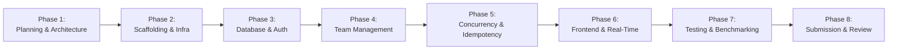

# CrewConnect — Comprehensive Implementation Roadmap

**Document:** Implementation Roadmap & Phase Execution Plan  
**Author:** Technical Lead & Engineering Project Planner  
**Status:** Finalized & Approved  
**Version:** 1.1.0

---

## 1. Roadmap Overview & Timeline

The CrewConnect engineering lifecycle is organized into eight distinct, sequential, quality-gated phases:

---

## 2. Phase-by-Phase Execution Plan

### Phase 1: Planning, Architecture & Repository Foundation _(Current Phase)_

- **Scope**:
  - Environment inspection and Git repository initialization.
  - Complete requirements analysis and Requirements Traceability Matrix.
  - End-to-end architecture, database schema, concurrency, API, security, and testing designs.
  - Formal Architecture Decision Records (ADRs) covering monorepo, data modeling, concurrency engine, npm, Mongoose, Argon2id, and leadership invariants.
  - Root monorepo scaffolding (`package.json`, `.gitignore`, `.editorconfig`, `.env.example`, READMEs).
- **Deliverables**: Complete architecture specifications in `docs/` and formal ADRs in `docs/adr/`.
- **Status**: Completed, verified, and finalized for review.

---

### Phase 2: Project Scaffolding & Infrastructure

- **Scope**:
  - Monorepo workspace configuration using **npm** (`apps/*`, `packages/*`).
  - TypeScript configurations (`tsconfig.base.json`, strict mode).
  - Docker Compose configuration orchestrating MongoDB Replica Set (`rs0`) with replica set initialization script (`scripts/init-replica-set.sh`).
  - `@crewconnect/shared` package initialization with shared TypeScript types and base Zod schemas.
  - GitHub Actions CI pipeline (`.github/workflows/ci.yml`).
- **Dependencies**: Phase 1 approval.
- **Deliverables**: Compiling TypeScript packages, green CI pipeline, and working single-node replica set in Docker Compose.

---

### Phase 3: Database & Authentication

- **Scope**:
  - Mongoose ODM connection setup with replica set connection pooling and transaction support.
  - Schema implementations for `users` and `hackathons`.
  - Password hashing service strictly with **Argon2id**.
  - JWT generation, validation, and `httpOnly` cookie middleware.
  - Input validation middleware consuming shared Zod schemas.
  - User registration, login, logout, and `/api/v1/auth/me` endpoints.
- **Dependencies**: Phase 2 infrastructure.
- **Deliverables**: Auth and User modules with passing integration tests.

---

### Phase 4: Core Team Management

- **Scope**:
  - Mongoose models for `teams`, `memberships`, `invitations`, `joinRequests`, `auditLogs`.
  - Enforce leadership invariants: leader must be active member, leader cannot leave without transfer, last-member departure disbands team.
  - Team creation with automatic leader membership assignment.
  - Team profile update and leader RBAC authorization middleware.
  - Paginated Team Discovery Board with text search and skill filtering.
  - Secret invite code generation (SHA-256 hashing) and direct user invitation workflow.
  - Join request submission and leader approve/reject workflows.
  - Voluntary departure, member removal, and atomic leadership transfer.
- **Dependencies**: Phase 3 auth and models.
- **Deliverables**: Teams, invitations, join-requests, and audit modules with passing integration tests.

---

### Phase 5: Race-Proof Membership Engine & Idempotency

- **Scope**:
  - Implementation of the **Unified Mongoose Transaction Engine** in `apps/api/src/modules/memberships`:
    1. Atomic capacity check and conditional reservation on team document
    2. Increment memberCount
    3. Insert active membership
    4. Insert audit log
    5. Persist idempotency record
       All within the same session-aware transaction.
  - Transient write conflict retry loop with jittered exponential backoff.
  - Scoped idempotency middleware with in-flight lock and payload hash verification.
  - Concurrency test harness testing 50 simultaneous join requests for 1 vacant seat.
  - Dual-join race test harness.
  - Background reconciliation script for capacity counter auditing.
- **Dependencies**: Phase 4 team models and indexes.
- **Deliverables**: Concurrency Engine with passing 50-user race test suite.

---

### Phase 6: Frontend & Real-Time Functionality

- **Scope**:
  - React 18 SPA setup with Vite, Tailwind CSS, and TanStack Query.
  - Authentication flow (Login, Register, Session recovery).
  - Interactive Team Discovery Board with live search, skill badges, and capacity indicators.
  - Team Profile page with roster, leader management tools, invite code generator modal.
  - Join Request applicant and leader management modals.
  - Socket.IO client integration for real-time seat decrements and instant notification toasts.
  - WCAG 2.1 AA keyboard accessibility and responsive layout optimization.
- **Dependencies**: Phase 4 and 5 API endpoints.
- **Deliverables**: Fully responsive Web application with real-time updates.

---

### Phase 7: Testing, Performance & Deployment

- **Scope**:
  - Seeding script `scripts/seed.ts` populating 10,000 users and 2,000 teams across hackathons.
  - Full test suite execution achieving $\ge 20$ API integration tests and $\ge 80\%$ test coverage.
  - k6 load testing execution validating 100 concurrent VUs and Discovery Board p95 latency $< 200\text{ ms}$.
  - Docker containerization for production (`Dockerfile` for API and Web).
- **Dependencies**: Phases 1–6 complete.
- **Deliverables**: Seeding script, k6 load test results, latency verification report.

---

### Phase 8: Documentation, Bonus Features & Final Submission

- **Scope**:
  - Final audit of submission deliverables against Hack4Hack 2026 PS1 guidelines.
  - Video walkthrough recording / live demonstration deployment.
  - Bonus feature evaluation (teammate recommendation engine scoring, audit export).
  - Final submission packaging and sign-off.
- **Dependencies**: Phase 7 passing results.
