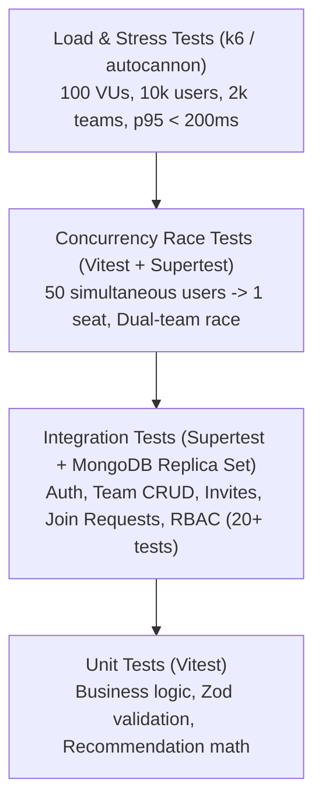

# CrewConnect — Comprehensive Testing & Quality Verification Strategy

**Document:** Testing & Verification Strategy  
**Author:** Senior Quality & Performance Engineer  
**Status:** Approved for Implementation  
**Version:** 1.0.0  

---

## 1. Testing Pyramid & Verification Philosophy

CrewConnect enforces a rigorous multi-tier testing strategy specifically tailored to verify concurrency invariants, high-throughput discovery latency, and domain business rules:

---

## 2. Test Suites & Categorization

### A. Unit Tests (`apps/api/tests/unit/**/*.test.ts`)
- **Framework**: Vitest (fast in-memory execution, native TypeScript support).
- **Target Logic**:
  1. **Team Capacity Logic**: Verifying that `memberCount < maxCapacity` checks behave correctly for edge values ($0, 1, 4, 5$).
  2. **Membership Business Rules**: Verifying that leaders cannot leave without leadership transfer.
  3. **Invitation Expiration & Hashing**: Token generation, SHA-256 verification, and TTL timestamp arithmetic.
  4. **Authorization & RBAC Guards**: Testing permission resolution for `LEADER`, `MEMBER`, and `PARTICIPANT`.
  5. **Recommendation Scoring**: Testing Jaccard coefficient and weighted skill overlap algorithms against known vectors.
  6. **Zod Validation Schemas**: Testing valid, malformed, and boundary inputs for all DTOs.

### B. Integration Tests (`apps/api/tests/integration/**/*.test.ts`)
- **Framework**: Supertest + Vitest against a live local MongoDB Replica Set.
- **Coverage**: Minimum $\ge 20$ comprehensive API integration tests:
  1. `test_auth_register_success`: Registers participant, checks password hash in DB.
  2. `test_auth_register_duplicate_email`: Rejects duplicate email with 409.
  3. `test_auth_login_valid_credentials`: Authenticates, sets `httpOnly` cookie.
  4. `test_auth_login_invalid_password`: Returns 401 with generic error.
  5. `test_team_create_leader_assigned`: Creates team, verifies creator is `LEADER`.
  6. `test_team_create_duplicate_in_hackathon`: Blocks user from creating second team (409).
  7. `test_team_discovery_filters`: Tests pagination, skill matching, and vacancy filtering.
  8. `test_team_update_by_leader`: Allows leader to update tagline/skills.
  9. `test_team_update_forbidden_for_member`: Non-leader update returns 403.
  10. `test_invite_code_generation`: Generates code, verifies DB stores SHA-256 hash.
  11. `test_invite_code_redemption`: Redeems code, verifies member added and uses count incremented.
  12. `test_invite_code_expired`: Rejects expired invite code with 400.
  13. `test_join_request_submission`: Creates pending request for open team.
  14. `test_join_request_leader_approve`: Approves request, adds member, closes request.
  15. `test_join_request_leader_reject`: Rejects request, leaves seat open.
  16. `test_member_voluntary_leave`: Member leaves, counter decrements 4 -> 3.
  17. `test_member_leader_cannot_leave`: Leader attempt to leave returns 400.
  18. `test_member_removal_by_leader`: Leader kicks member, counter decrements.
  19. `test_member_removal_by_non_leader`: Non-leader kick returns 403.
  20. `test_leadership_transfer_atomic`: Transfers leadership, updates roles and `team.leaderId`.
  21. `test_idempotency_duplicate_post`: Repeats POST with identical key, returns cached response.
  22. `test_audit_log_generation`: Confirms audit entries written for state mutations.

### C. Concurrency Race Tests (`apps/api/tests/concurrency/**/*.test.ts`)
- **Key Test 1: The 50-Simultaneous-Users Race for 1 Seat**:
  - **Setup**: Seed 1 team with `memberCount: 4`, `maxCapacity: 5`.
  - **Execution**: Create 50 distinct registered user tokens. Fire 50 simultaneous `POST /teams/:id/join` requests using `Promise.all()`.
  - **Assertions**:
    - Exactly **1** HTTP response has status `201 Created`.
    - Exactly **49** HTTP responses have status `409 Conflict` with code `TEAM_FULL`.
    - Team document in MongoDB has `memberCount === 5`.
    - `MembershipModel.countDocuments({ teamId, status: "ACTIVE" }) === 5`.
    - Exactly 1 new audit log record with action `MEMBER_JOINED`.
- **Key Test 2: Dual-Team Competing Join Race**:
  - User A is invited to Team X (capacity 5, currently 3) and Team Y (capacity 5, currently 4).
  - Fire simultaneous join requests for both teams.
  - **Assertion**: Exactly 1 request succeeds (201); 1 request fails with `409 ALREADY_IN_TEAM`. User belongs to exactly 1 team. The rejected team's counter does not increment.
- **Key Test 3: Idempotent Retries Under High Contention**:
  - User submits request with `Idempotency-Key: key-123`.
  - Fire 10 simultaneous requests with the identical key.
  - **Assertion**: All 10 return the exact same response; only 1 membership is created.

### D. Load & Performance Testing (`scripts/k6/load-test.js`)
- **Tooling**: k6 / autocannon.
- **Seeded Dataset**:
  - $10,000$ users.
  - $2,000$ teams across 5 active hackathons.
- **Scenario Profile**:
  - 100 concurrent Virtual Users (VUs) executing for 3 minutes.
  - Workflow: 80% reading/filtering Team Discovery Board (`GET /api/v1/hackathons/:id/teams`), 15% viewing team profiles, 5% submitting join requests.
- **Acceptance Thresholds**:
  - Discovery Board p95 latency: $< 200\text{ ms}$.
  - HTTP error rate: $< 0.1\%$ on read paths.

---

## 3. Test Reporting & CI Pipeline Integration

- Vitest outputs JUnit XML and coverage reports (`cobertura` / `lcov`) to `coverage/`.
- GitHub Actions CI blocks pull requests if:
  1. Any of the 20+ API integration tests fail.
  2. The 50-user concurrency race test does not yield exactly 1 success and 49 rejections.
  3. Total branch or statement coverage falls below 80%.
  4. Any TypeScript compiler error or ESLint warning is detected.
