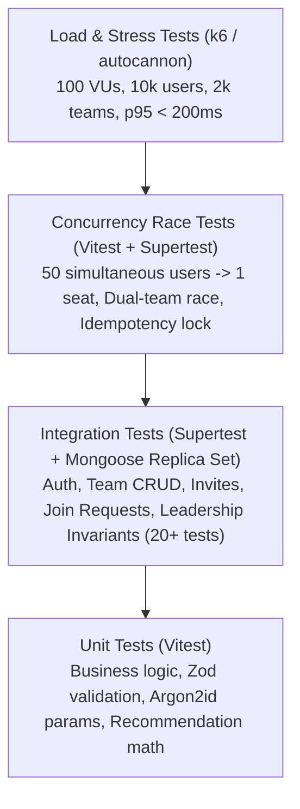

# CrewConnect — Comprehensive Testing & Quality Verification Strategy

**Document:** Testing & Verification Strategy  
**Author:** Senior Quality & Performance Engineer  
**Status:** Finalized & Approved  
**Version:** 1.1.0  

---

## 1. Testing Pyramid & Verification Philosophy

CrewConnect enforces a multi-tier testing strategy specifically tailored to verify concurrency invariants, high-throughput discovery latency, and domain business rules:

---

## 2. Test Suites & Categorization

### A. Unit Tests (`apps/api/tests/unit/**/*.test.ts`)
1. **Argon2id Parameters & Hashing**: Verifies salt generation, hashing execution, and verification logic.
2. **Team Capacity Logic**: Tests boundary conditions on team size ($0, 1, 4, 5$).
3. **Leadership Invariants**: Verifies that a leader cannot leave without transfer, and verifies last-member disbandment triggers.
4. **Invitation Token Hashing**: Tests SHA-256 token generation and constant-time comparison.
5. **Idempotency Hash Verification**: Tests SHA-256 payload fingerprinting and mismatch detection.
6. **Zod Validation Schemas**: Tests boundary values and injection payloads across all DTOs.

### B. Integration Tests (`apps/api/tests/integration/**/*.test.ts`)
Minimum $\ge 20$ comprehensive passing tests against a local MongoDB Replica Set:
1. `test_auth_register_argon2id`: Registers participant, checks Argon2id hash format in DB.
2. `test_auth_register_duplicate_email`: Rejects duplicate email with 409.
3. `test_auth_login_valid_credentials`: Authenticates, sets `httpOnly` cookie.
4. `test_auth_login_invalid_password`: Returns 401 with generic error.
5. `test_team_create_leader_assigned`: Creates team, verifies creator is `LEADER`.
6. `test_team_create_duplicate_in_hackathon`: Blocks user from creating second team (409).
7. `test_team_discovery_filters`: Tests pagination, skill matching, and vacancy filtering.
8. `test_team_update_by_leader`: Allows leader to update tagline/skills.
9. `test_team_update_forbidden_for_member`: Non-leader update returns 403.
10. `test_invite_code_generation`: Generates code, verifies DB stores SHA-256 hash.
11. `test_invite_code_redemption`: Redeems code, verifies member added and uses count incremented.
12. `test_invite_code_expired`: Rejects expired invite code with 400.
13. `test_join_request_workflow`: Creates pending request, verifies leader approval adds member.
14. `test_member_voluntary_leave`: Member leaves, counter decrements 4 -> 3.
15. `test_member_leader_cannot_leave`: Leader attempt to leave multi-member team returns 400.
16. `test_member_last_departure_disbands_team`: Sole member leaving automatically disbands team.
17. `test_member_removal_by_leader`: Leader kicks member, counter decrements.
18. `test_leadership_transfer_atomic`: Transfers leadership, updates roles and `team.leaderId`.
19. `test_leadership_transfer_invalid_target`: Transfer to non-member fails with 400.
20. `test_idempotency_duplicate_replay`: Replays request with identical key, returns cached response.
21. `test_idempotency_payload_mismatch`: Reuses key with different payload, returns 409 Conflict.
22. `test_audit_log_generation`: Confirms audit entries written within transaction.

### C. Concurrency Race Tests (`apps/api/tests/concurrency/**/*.test.ts`)
1. **The 50-Simultaneous-Users Race for 1 Seat**:
   - **Setup**: Team with `memberCount: 4`, `maxCapacity: 5`.
   - **Execution**: 50 distinct registered user tokens issue `POST /teams/:id/join` simultaneously via `Promise.all()`.
   - **Assertions**:
     - Exactly **1** HTTP response has status `201 Created`.
     - Exactly **49** HTTP responses have status `409 Conflict (TEAM_FULL)` after transaction retries.
     - Final `team.memberCount === 5`.
     - `Membership.countDocuments({ teamId, status: "ACTIVE" }) === 5`.
     - Exactly 1 new audit log record with action `MEMBER_JOINED`.
2. **Dual-Team Competing Join Race**:
   - User A attempts to join Team X and Team Y concurrently in the same hackathon.
   - **Assertions**: Exactly 1 succeeds (201); 1 fails with `409 ALREADY_IN_TEAM`. The failed team's counter does NOT increment.
3. **Transaction Rollback on Secondary Failure**:
   - Inject a failure after capacity increment (e.g. simulated unique index conflict).
   - **Assertion**: Transaction aborts completely; `team.memberCount` remains at original value (no permanent orphaned increment).
4. **In-Flight Concurrent Idempotency Race**:
   - 2 concurrent requests arrive with the same key simultaneously.
   - **Assertion**: 1 proceeds to execute; 1 is rejected with `409 REQUEST_IN_PROGRESS`.

### D. Load & Performance Testing (`scripts/k6/load-test.js`)
- **Dataset**: $10,000$ participants, $2,000$ teams.
- **Concurrency**: 100 concurrent Virtual Users (VUs) over 3 minutes.
- **Threshold**: Discovery Board p95 latency $< 200\text{ ms}$. Error rate $< 0.1\%$.
